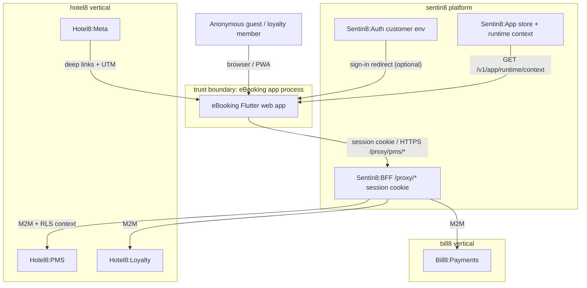
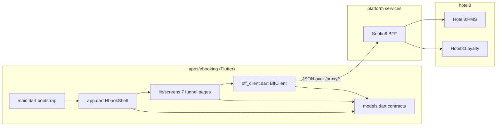
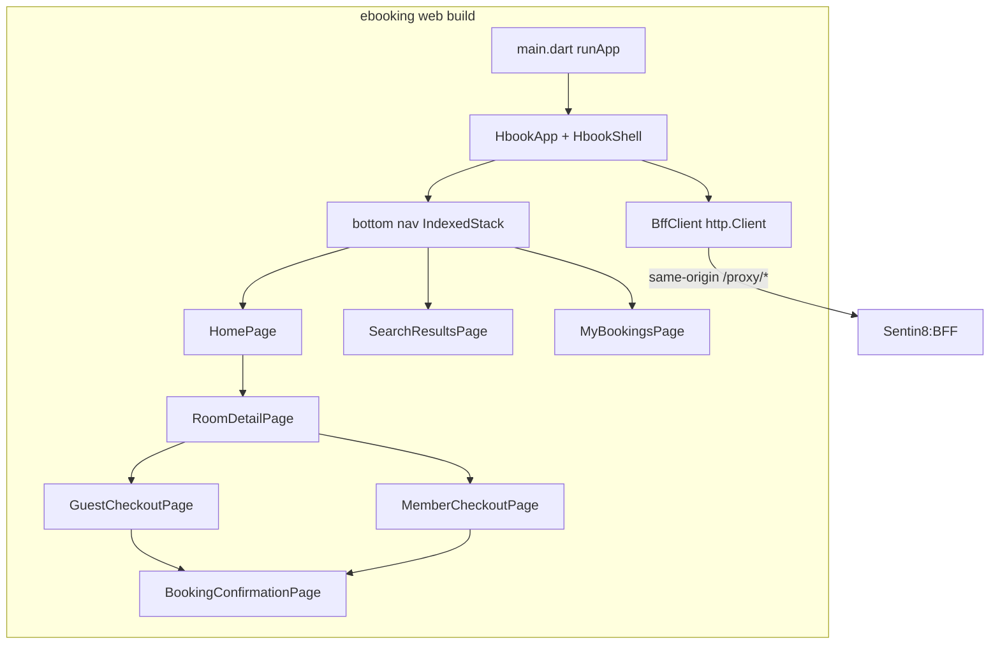
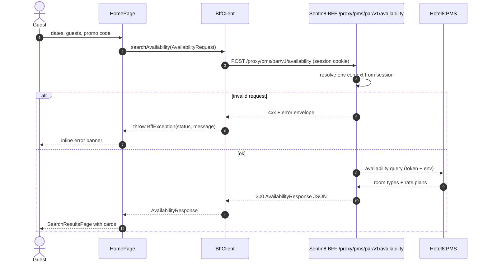
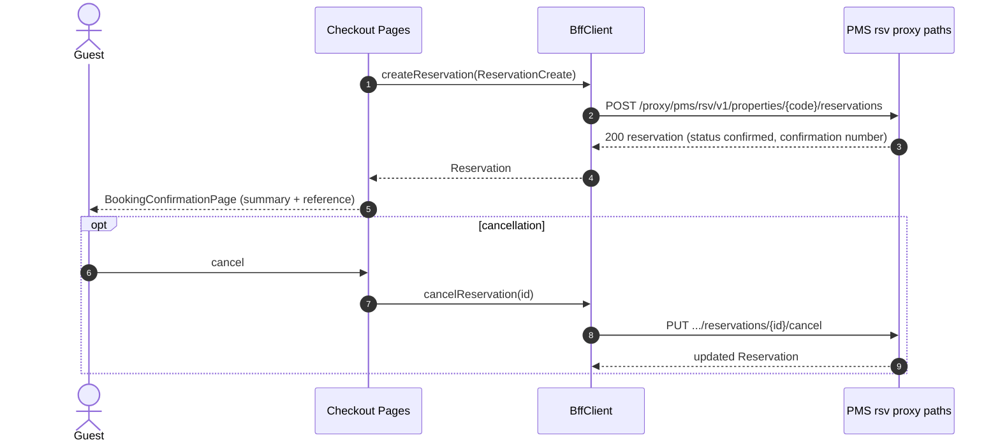
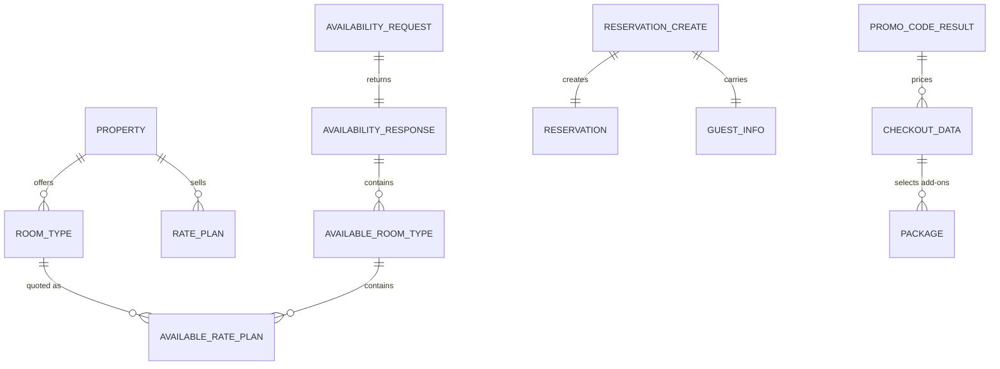
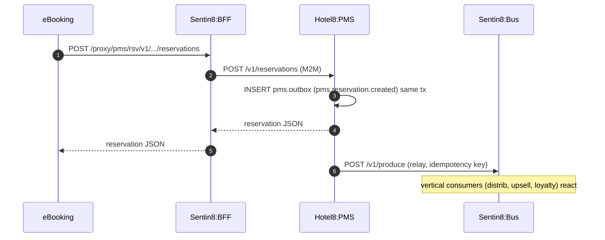
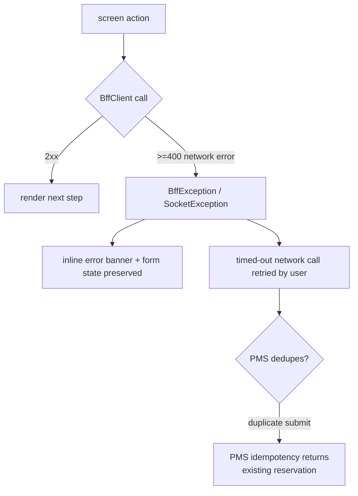
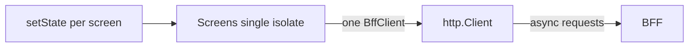
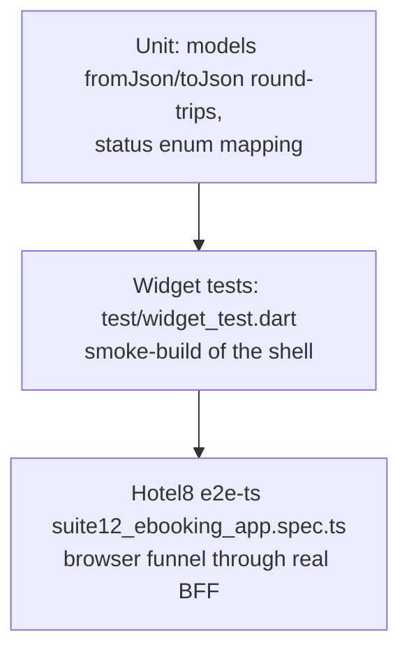

# Hotel8:eBooking - Detailed Design Document

## 1. Scope & Context

**Owned by the eBooking app:**

- The booking-funnel user experience: home/landing, availability search, room
  detail with rate-plan comparison, guest and member checkout, booking
  confirmation, and My Bookings.
- The client-side contract layer (`lib/models.dart`) mirroring the Hotel8:PMS
  public contract shapes.
- The BFF proxy call surface for the booking funnel (`lib/bff_client.dart`).

**Explicitly NOT owned (consuming/delegating):**

| Concern | Owner |
|---|---|
| Availability, rates, inventory, reservations, folios | Hotel8:PMS |
| Card guarantee / deposit tokenization | Bill8:Payments (via BFF) |
| Loyalty membership, member rates, points preview | Hotel8:Loyalty |
| Confirmation email/SMS delivery | Sentin8:Post (BFF-initiated) |
| Property/room image object storage | Sentin8:Storage (via PMS content refs) |
| Token custody, session issuance, authorization decision | Sentin8:Auth + Shield (BFF token guardian) |
| Post-booking in-stay experience | Hotel8:eGuest |
| OTA/channel distribution | Hotel8:Distrib |
| Staff PMS operations | Hotel8:ePMS |
| App store listing, runtime context, DCR bootstrap | Sentin8:App + Sentin8:Auth |

### System context

### Container view

## 2. Runtime Architecture

Component responsibilities:

- `main.dart` - entry point, instantiates the shell.
- `app.dart` - `HbookApp` (Material theming, seed color) and `HbookShell`
  (bottom navigation `IndexedStack`, owns the single `BffClient`, threads
  `propertyCode` into screens). Bootstrap also **parses the landing URL's
  query parameters** (metasearch deep-link context): `utm_source`,
  `utm_medium`, `utm_campaign`, `rate_plan`, and `room_type` are captured
  into a `MetasearchContext` and flow through the funnel - the search tab
  pre-fills room type/rate plan and the booking payload carries the UTM
  fields, so the confirmation attributes the stay to the ad channel
  (`Hotel8:Meta` deep-link traffic with UTM context per BUSINESS.md §8).
- **Multi-property landing** - when the environment hosts more than one
  property the funnel starts at the property-picker view of the home tab
  (`_propertiesForEnv` already reads the registry); search/results/booking
  all carry the selected property id, and the org-wide availability endpoint
  (`GET /v1/availability`) covers cross-property search.
- `lib/screens/*.dart` - one `StatefulWidget` per funnel step; each receives
  `client` (+ property context) via constructor and pushes the next step with
  `Navigator.push`.
- `models.dart` - immutable contract classes with `fromJson`/`toJson`
  round-trippers.
- `bff_client.dart` - typed wrappers over the `…/v1/…` proxy paths, one method
  per endpoint, `BffException` for error surfacing.

### Request lifecycle - availability search

### Request lifecycle - reservation booking

## 3. Data Model

The app persists nothing. All state is server-side (PMS tables) or transient
UI state. The models below are client projections of PMS contract rows -
see `services/pms/DESIGN.md` §3 for the authoritative tables.

Notes:

- `Property` carries identity (`propertyCode`), locale (`timezone`,
  `currencyCode`, languages), display address and contacts - everything the
  landing page and checkout tax/currency context needs.
- `ReservationStatus` is the enum the UI renders through the funnel;
  the authoritative lifecycle lives on the PMS reservation row.
- `PromoCodeResult` prices a code without committing - validation is
  read-only until the reservation is created.

## 4. API Surface

All client calls go to Sentin8:BFF. Authorization is the BFF's session cookie
→ token guardian; the app itself performs no token inspection. Paths as
implemented in `bff_client.dart` (audience: public guest / signed-in member):

| Method & action | Proxy path | Backend |
|---|---|---|
| Search availability | `POST /proxy/hotel8-pms/v1/properties/{p}/availability` | Hotel8:PMS |
| Property registry / content | `GET /proxy/hotel8-pms/v1/properties`, `GET .../properties/{p}` | Hotel8:PMS |
| List room types | `GET /proxy/hotel8-pms/v1/properties/{p}/room-types` | Hotel8:PMS |
| Room type detail | `GET /proxy/hotel8-pms/v1/properties/{p}/room-types/{id}` | Hotel8:PMS |
| List rate plans | `GET /proxy/hotel8-pms/v1/properties/{p}/rate-plans` | Hotel8:PMS |
| List packages | `GET /proxy/hotel8-pms/v1/properties/{p}/packages` | Hotel8:PMS |
| Ensure profile + create reservation | `POST .../properties/{p}/profiles`, `POST .../reservations` | Hotel8:PMS |
| List my reservations | `GET .../reservations?guest_profile_id=` | Hotel8:PMS |
| Cancel reservation | `POST .../reservations/{id}/cancel` | Hotel8:PMS |
| Validate promo | `POST .../promo/validate` | Hotel8:PMS |

### Event flow

The app is a pure client - it emits no platform events and consumes none. The
domain events of the funnel (reservation creation, cancellation) originate in
Hotel8:PMS; their outbox → Bus → trigger chain is specified in
`services/pms/DESIGN.md` §4.

## 5. Cross-Cutting Concerns

- **Authentication:** the app delegates to the BFF session. Anonymous guests
  get an unauthenticated session; signed-in members carry a customer-env
  session cookie. No tokens, no JWKS access, no redirect flows inside the
  app.
- **Tenant resolution:** the BFF resolves env from the app's session/host and
  enforces RLS downstream; the app never passes tenant identifiers.
- **Idempotency & exactly-once:** reservation creation is a synchronous
  request/response guarded downstream by PMS (confirmation-number uniqueness,
  inventory decrement in one transaction); retry-safe behavior is owned
  there, not in the UI.
- **Rate limiting / bot protection:** search endpoints are rate-limited at
  the BFF/proxy edge for scraping resilience; the app simply handles 4xx.
- **Audit:** mutations are audited by PMS (its journal + push); the client
  adds no audit of its own.
- **TLS posture:** the browser/PWA runs over Sentin8:TLS-terminated origins;
  dev HTTP fallback exists only for native (`kIsWeb == false`) localhost.
- **Upgrade drain:** stateless single-page build - upgrades of the web asset
  serving require no in-app drain logic.

## 6. Failure Modes & Recovery

- **Non-2xx:** `BffException(status, message)` is thrown to the screen; the
  screen keeps form values intact so the guest can correct and resubmit.
- **Duplicate submission:** PMS-side uniqueness (confirmation number,
  inventory) folds a double-tap into one reservation; the UI tolerates a
  second submit.
- **Server unreachable:** an error banner on the current step; no local
  queueing - a booking either happens server-side now or not at all (the
  funnel is short, stateless retry is cheap).
- **Web asset upgrade:** not applicable; stateless client.

## 7. Concurrency & Performance Model

- Single Flutter isolate; all calls `async`/`await` with no concurrent fan-out
  beyond independent GETs a screen issues in parallel (`Future.wait`-style in
  screens where needed).
- No caches - property content, rate plans and availability are re-fetched on
  entry to keep freshness (rate accuracy beats latency for a booking engine).
- The `http.Client` is one instance for the app lifetime, closed in
  `dispose`.
- Hot path is availability search; payloads are single-digit-KB JSON and the
  response mapping is O(n) over room types.

## 8. Invariants, Insecure-Defaults Rejected, Unsafe Rationale

**Invariants (always true):**

1. All outbound paths begin with `/proxy/`.
2. Non-2xx responses surface only as `BffException`.
3. Every screen receives `client` (and property context) via constructor -
   no screens construct their own client.
4. Models are immutable and round-trip via `toJson`.
5. The app contains no secrets, tokens, or card data - guarantee/charge data
   handling lives server-side behind the BFF.

**Insecure defaults rejected:** direct-to-service URLs from the app; token or
card capture in browser storage; client-side price arithmetic treated as
authoritative (totals are advisory; PMS prices authoritatively).

**Unsafe code:** none (`dart analyze` clean; no `unsafe`/platform channels).

## 9. Testing Strategy

- **Unit** - contract mappers own `fromJson`/`toJson` symmetry; future
  price-arithmetic helpers would live here.
- **Widget** - the shell renders its navigation and first screen.
- **E2E** - `e2e-ts/tests/ui/suite12_ebooking_app.spec.ts` drives the funnel
  as a real user through the BFF proxy (`fixtures/apiclient.ts` uses the same
  proxy paths); deliberately NOT tested: PMS internals, RLS (covered by the
  pms service test suite).

## 10. Open Questions

- Customer-env sign-in/sign-up and payment-guarantee tokenization: whether
  the funnel integrates the shared `BffAuthProvider` or continues
  server-side-only session handling once real card guarantee flows land.
- Schema.org markup lives in the Flutter web shell (`web/index.html` + the
  document head set from property content); sitemap generation rides the
  App web-serving layer. Full SSR (server-rendered HTML) is a serving-layer
  decision, not an app change - the app ships the `web/index.html` SEO
  surface and JSON-LD property data.
- Runtime-context wiring (property code, branding, languages from
  `GET /v1/app/runtime/context`) is implemented; branding theming per
  org/env (`sentin8_sys_branding`) remains open on the serving side.

---

**Architecture & Design:** hotel8:ebooking and its underlying concepts were designed by [Hamid Jahanzad](https://www.linkedin.com/in/hamidjahanzad/).

