# Hotel8:eCorpBooking - Detailed Design Document

## 1. Scope & Context

**Owned by the eCorpBooking app:**

- The corporate portal UX: corporate login (code + SSO), dashboard, corporate
  search & book, traveler management, My Trips, reporting, and company
  profile.
- The client-side corporate aggregate model (`lib/models.dart`).
- The BFF proxy call surface for the corporate flows (`lib/bff_client.dart`).

**Explicitly NOT owned (consuming/delegating):**

| Concern | Owner |
|---|---|
| Company profiles, negotiated rate plans, bookings, policy storage | Hotel8:PMS (crm/rtp/rsv corporate paths) |
| Corporate login/SSO/verify endpoints | Sentin8:Auth (via BFF) |
| Payment acceptance | Bill8:Payments (via BFF) |
| Corporate invoicing / post-pay ledger | Bill8:Ledger (server-side) |
| Announcements delivery | Sentin8:Post |
| Leisure booking funnel | Hotel8:eBooking |
| Corporate client setup, rate negotiation | Hotel8 sales (service-side) |
| Corporate `/admin` configuration | Service RFW admin surface |
| Token custody, session issuance, authorization decision | Sentin8:Auth + Shield (BFF token guardian) |

### System context

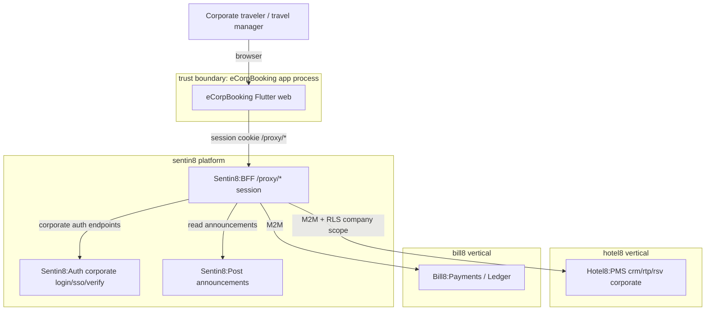

### Container view

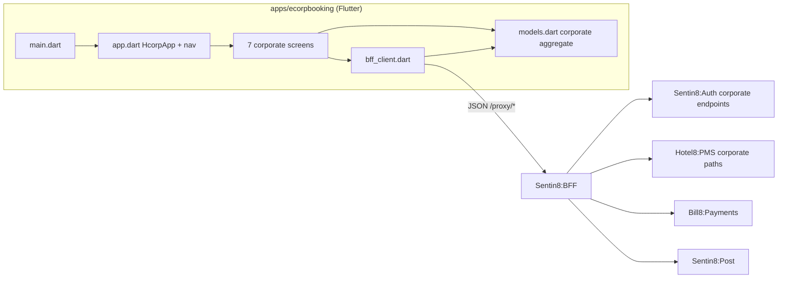

## 2. Runtime Architecture

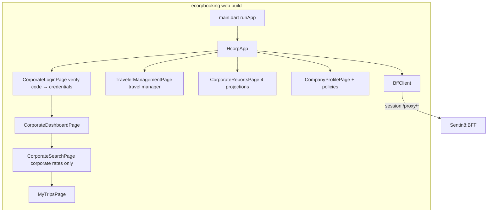

- `main.dart` / `app.dart` - entry + shell navigation.
- `screens/*.dart` - the 7 corporate screens; login verifies the company
  code before credentials; travel-manager screens are role-gated by the
  session.
- `models.dart` - company/traveler/booking/policy/report contracts.
- `bff_client.dart` - typed corporate endpoints.

### Request lifecycle - corporate login and company binding

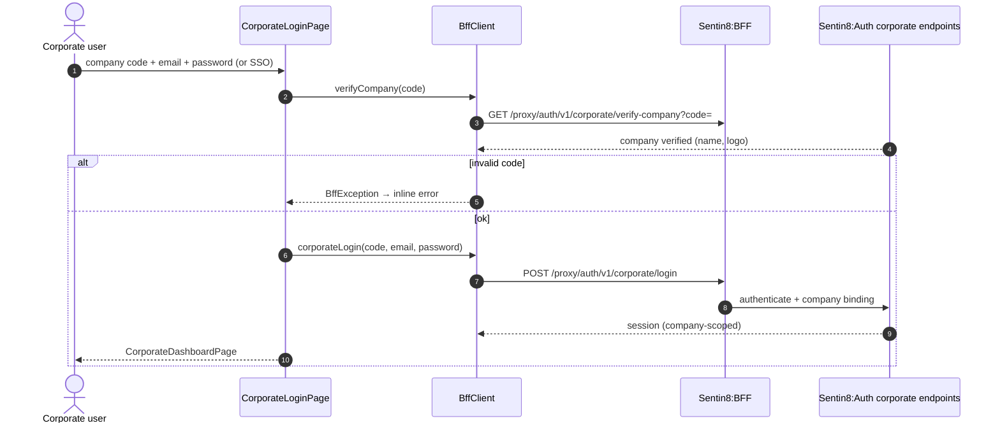

### Request lifecycle - policy-guarded corporate booking

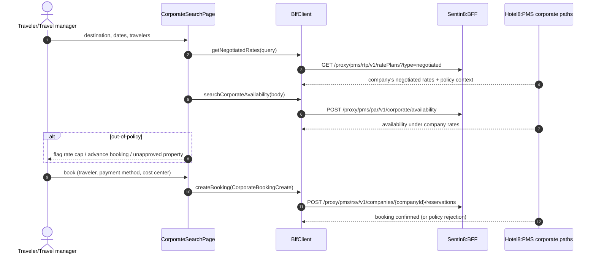

## 3. Data Model

No persistence; client projections of PMS CRM/rate/reservation rows
(authoritative: `services/pms/DESIGN.md` §3):

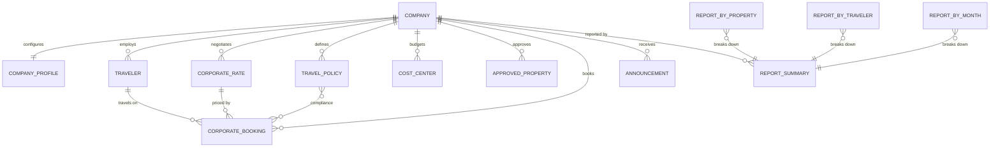

State machines rendered client-side (authority in PMS/Auth):

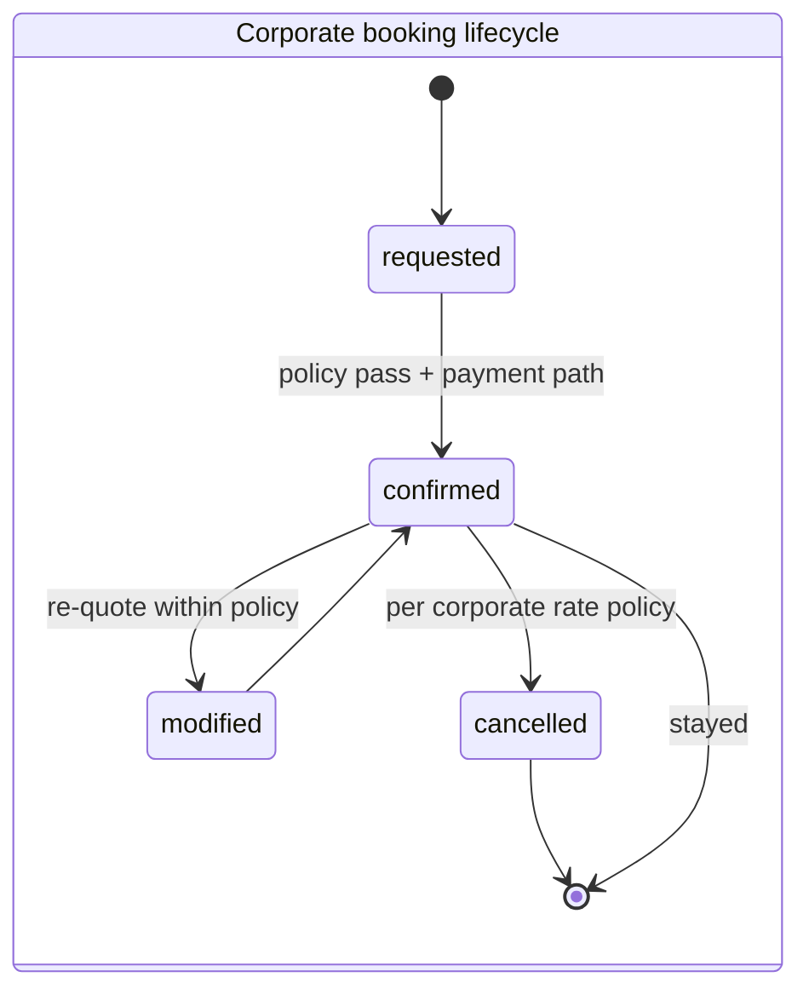

Notes: `TravelerRole` distinguishes who sees management screens;
`PaymentMethod` maps to post-pay/bill-to-company terms requiring
credit-approval state owned by the hotel's sales team; `TravelPolicy`
carries rate caps, advance-booking windows and approved properties the
server enforces.

## 4. API Surface

All calls traverse the BFF with the corporate session cookie. Audience:
corporate travelers/travel managers (scope-gated downstream). Paths as
implemented in `bff_client.dart`:

| Group | Endpoints (method + proxy path) | Backend |
|---|---|---|
| Auth | `POST /proxy/auth/v1/sign-in` (standard identity; no vertical Auth endpoints) | Sentin8:Auth |
| Company | `GET/PUT /proxy/hotel8-pms/v1/properties/{p}/profiles/{id}`, `GET .../profiles?profile_type=COMPANY&q=` (verify) | Hotel8:PMS |
| Rates | `GET /proxy/hotel8-pms/v1/properties/{p}/negotiated-rate-plans` | Hotel8:PMS |
| Availability | `POST /proxy/hotel8-pms/v1/properties/{p}/availability` (company profile in body) | Hotel8:PMS |
| Bookings | `POST/GET /proxy/hotel8-pms/v1/properties/{p}/reservations`, `PUT .../{id}`, `POST .../{id}/cancel` | Hotel8:PMS |
| Credit methods | `GET /proxy/hotel8-pms/v1/properties/{p}/companies/{id}/payment-methods?approved_only=true` - credit-approved methods (post-pay / bill-to-company) the checkout can bill | Hotel8:PMS (corporate surfaces) |
| Company switching | `GET /proxy/hotel8-pms/v1/properties/{p}/companies/by-traveler/{id}` - the companies the signed-in traveler is bound to (`pms.company_users`) | Hotel8:PMS |
| Corporate availability (rate-mix) | `POST /proxy/hotel8-pms/v1/properties/{p}/corporate-availability` - availability restricted to the negotiated plans linked to the calling company (`preferences.negotiated_rate_plan_ids`); public plans are withheld when a company context is supplied (pms/DESIGN.md §4) | Hotel8:PMS |
| SSO-free first-admin provisioning | `GET/PUT /proxy/hotel8-pms/v1/properties/{p}/companies/{id}/admin-provisioning` - decides + provisions the first corporate admin for companies without an IdP (`pms.company_users` ADMIN row) | Hotel8:PMS |
| Users roster | `GET/POST /proxy/hotel8-pms/v1/properties/{p}/companies/{id}/users` - traveler bindings with role-at-company | Hotel8:PMS |
| Travelers | Company-linked GUEST profiles via `.../profiles` | Hotel8:PMS |
| Policies | Company-profile field set (via profile update) | Hotel8:PMS |
| Announcements | `GET /proxy/post/v1/messages?category=ANNOUNCEMENT` | Sentin8:Post |
| Reports | `GET .../reports/{reservation-summary|channel-performance|guest-history|occupancy}` | Hotel8:PMS |

### Event flow

The app emits no events. Corporate bookings produce PMS reservation events;
traveler/policy changes produce CRM events; chains belong to the owning
services (`services/pms/DESIGN.md` §4).

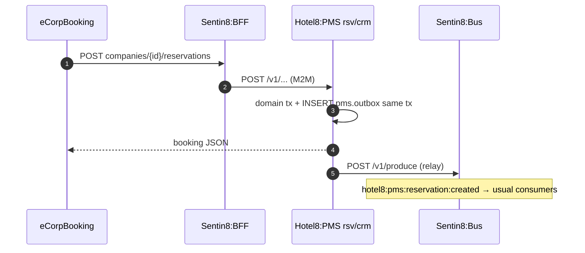

## 5. Cross-Cutting Concerns

- **Authentication:** corporate session (email/password or SSO) brokered via
  the BFF corporate auth endpoints; company code is verified pre-login;
  tokens server-side only.
- **Tenant resolution + RLS:** company scoping rides the BFF session →
  downstream RLS; a company's data is invisible to other sessions.
- **Idempotency & exactly-once:** booking create/modify/cancel are server
  transactions with policy preconditions; double submits fold server-side.
- **Rate limiting / bot protection:** company-code verification endpoints
  are edge-limited; failures never confirm code validity.
- **Audit:** PMS journals corporate mutations; reporting is read-back.
- **TLS posture:** Sentin8:TLS-terminated origins; corporate rate data never
  crosses to the public eBooking channel.
- **Upgrade drain:** stateless SPA.

## 6. Failure Modes & Recovery

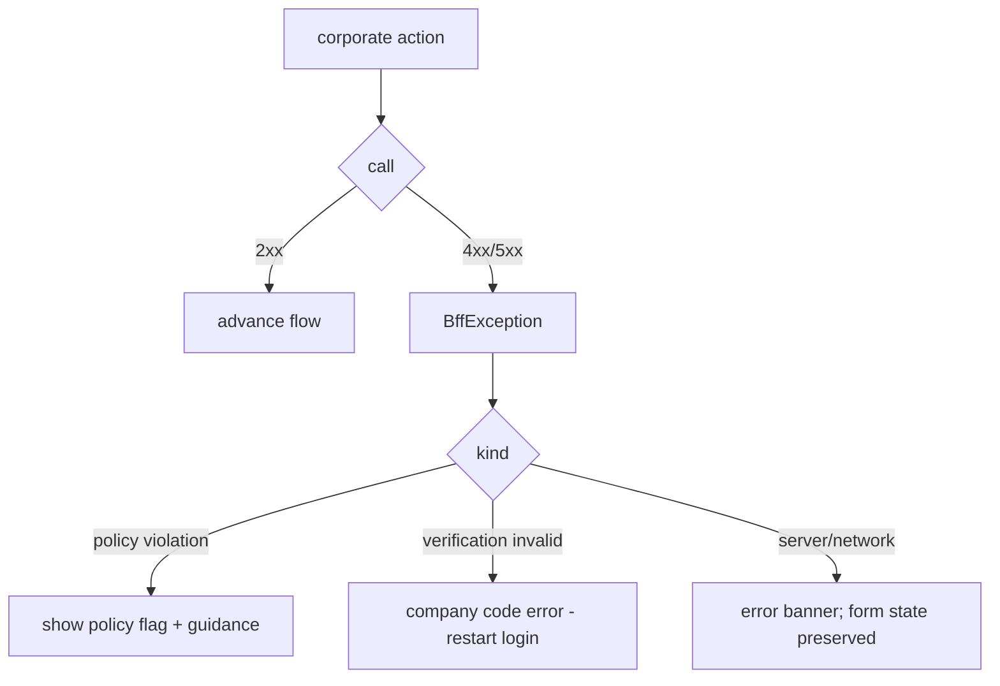

- **Out-of-policy booking attempts** return the policy flags; the user
  corrects within policy or the attempt stands as flagged (server policy
  decides blocking vs. flag).
- **Company deactivation / expired terms:** session endpoints reject; the
  login flow surfaces the failure.
- **Report gaps:** empty report projections render as empty states, never as
  zeros (no fabricated data).

## 7. Concurrency & Performance Model

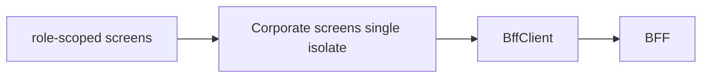

- Single isolate; async per action; report queries are parameterized by
  date range to bound payloads.
- No caching of rate data (negotiated rates change with terms); roster and
  policies refetch on entry.
- One `http.Client` closed by the shell.

## 8. Invariants, Insecure-Defaults Rejected, Unsafe Rationale

**Invariants (always true):**

1. Booking/rate paths always carry the company segment
   (`/companies/{companyId}/...`); no company-less corporate booking path is
   called.
2. Negotiated rates arrive only for the authenticated company.
3. Policy decisions are server-side; the UI flags, never permits.
4. Traveler/policy administration is role-scoped server-side.
5. Non-2xx ⇒ `BffException`; models round-trip; paths all `/proxy/*`.

**Insecure defaults rejected:** client-side rate filtering of public
results; client-enforced policy as the only gate; storing company code or
credentials beyond the login form; sharing rate data across company
sessions.

**Unsafe code:** none.

## 9. Testing Strategy

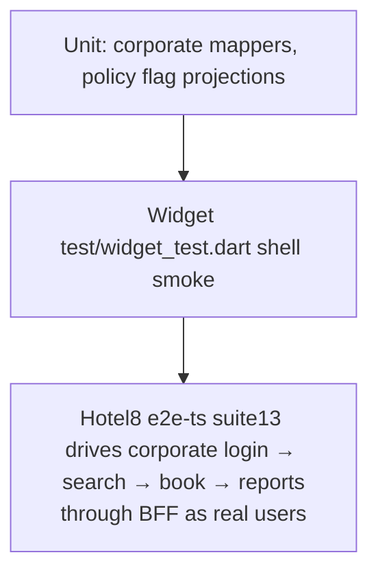

- **Unit** - contract mappers and role/policy projection logic.
- **Widget** - shell and screen mounting.
- **E2E** - `e2e-ts` covers the corporate journey through browser + BFF;
  deliberately NOT tested here: PMS CRM/rate domain rules, policy engine
  internals (service-owned).

## 10. Open Questions

- Corporate display-ordering/priority between published and negotiated rates
  when both apply to one stay is an open revenue decision (the rate-mix
  itself - company-scoped negotiated-only availability - is implemented, §4).
- The corporate sales-side `/admin` configuration rides the Hotel8:PMS admin
  RFW pages (companies roster, credit methods, user bindings, negotiated-rate
  links - pms/DESIGN.md §4); a dedicated in-app admin console for hotel sales
  staff is not planned - Dash renders the RFW pages.

The SSO-free first-admin provisioning, multi-company binding, and
credit-method checkout surfacing are implemented (§4; the Request Access
sheet provisions the first admin via the admin-provisioning surface).

---

**Design attribution:** hotel8:ecorpbooking and its underlying concepts were designed by Hamid Jahanzad <Hamid@Jahanzad.com>.

