# Hotel8:eGuest - Detailed Design Document

## 1. Scope & Context

**Owned by the eGuest app:**

- The guest journey UX: pre-arrival (pre-check-in, upsell offers), check-in
  with digital key, in-stay (service requests, messaging, folio review,
  quick pay), check-out, post-stay (feedback, stay history), and profile
  preferences.
- The client-side contract layer (`lib/models.dart`) for the stay aggregate,
  guest interactions, and loyalty/profile projections.
- The BFF proxy call surface for guest actions (`lib/bff_client.dart`).

**Explicitly NOT owned (consuming/delegating):**

| Concern | Owner |
|---|---|
| Reservations, registration cards, room assignment, key issuance, messages, service requests | Hotel8:PMS (fof/rsv) |
| Folio state, check-out posting | Hotel8:PMS cashiering (csh) |
| Offer generation and pricing | Hotel8:Upsell |
| Payment acceptance for folio/express check-out | Bill8:Payments (via BFF) |
| Loyalty member data, transactions | Hotel8:Loyalty |
| Notification push/email delivery | Sentin8:Post |
| Booking funnel (new reservations) | Hotel8:eBooking |
| Lobby self-service hardware key dispensing | Hotel8:eKiosk |
| Staff-side response handling | Hotel8:ePMS |
| Authorization decision, token custody | Sentin8:Auth + Shield (BFF-guarded) |

### System context

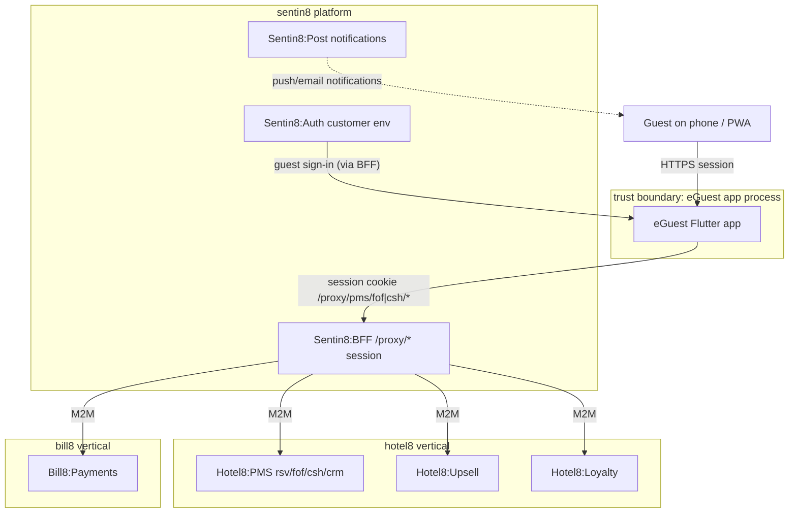

### Container view

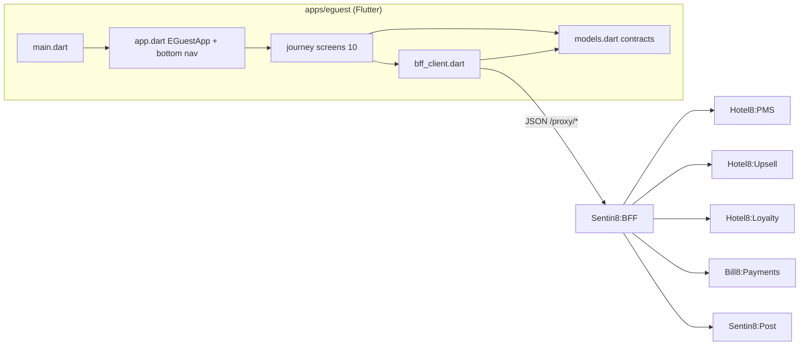

## 2. Runtime Architecture

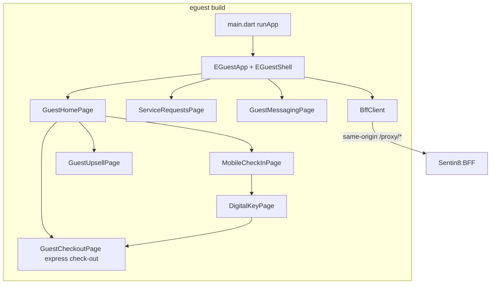

- `main.dart` / `app.dart` - entry + shell with bottom navigation; owns the
  single `BffClient`; `export 'screens/guest_home_page.dart'` composes the
  journey screens.
- `screens/*.dart` - 10 journey screens; each fetches its own data on entry
  and pushes the next journey step.
- `models.dart` - 20+ contract classes/enums, request bodies included.
- `bff_client.dart` - typed wrappers per proxy endpoint.

### Request lifecycle - mobile check-in

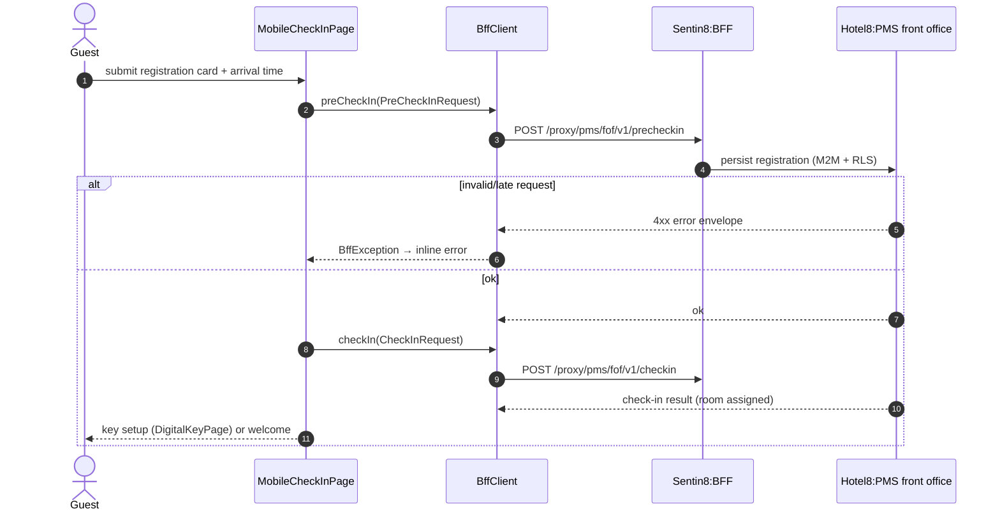

### Request lifecycle - express check-out with folio payment

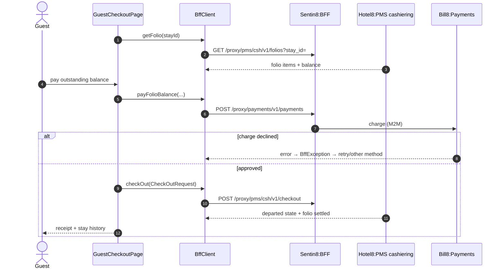

## 3. Data Model

No persistence in the app; all rows are PMS/loyalty/upsell-owned. Client
projections:

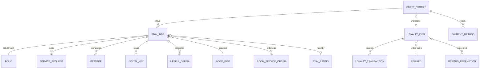

State machines rendered client-side (authoritative in the services):

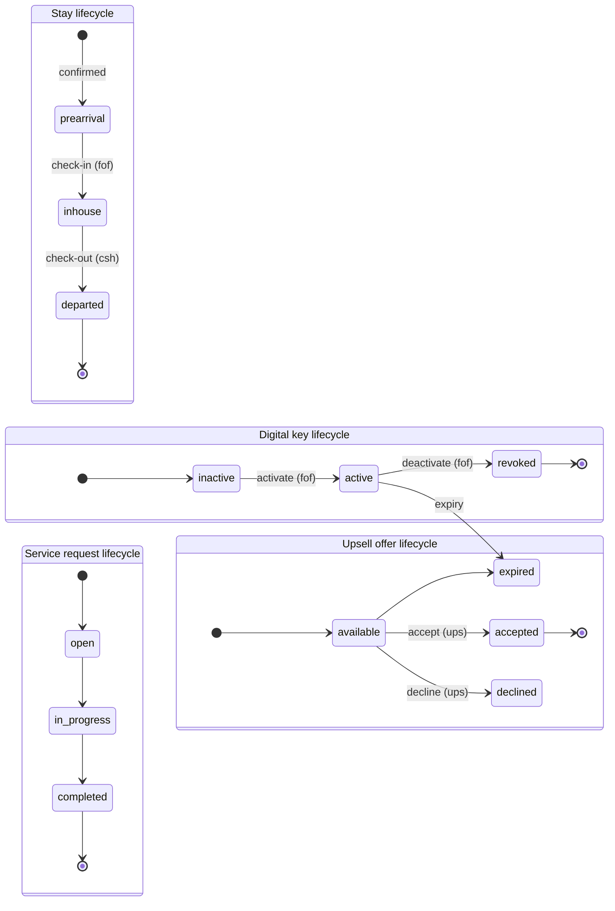

Notes: `StayInfo` is the journey anchor - screens gate actions on it
(pre-check-in only pre-arrival, folio review only in-house, etc.). `Message`
is direction-typed (`incoming`/`outgoing`). `UpsellOffer` carries category and
pricing for the one-tap funnel.

## 4. API Surface

All guest actions traverse the BFF (guest session). Audience: hotel guest
(scope-gated downstream, e.g. `hotel8:pms:reservations:read`,
`hotel8:pos:orders:write`). Paths as implemented in `bff_client.dart`:

| Group | Endpoints (method + proxy path) | Backend |
|---|---|---|
| Stays | `GET /proxy/hotel8-pms/v1/properties/{p}/reservations?guest_profile_id=&upcoming=`, `GET .../reservations/{id}` | Hotel8:PMS |
| Pre-arrival/check-in | `POST .../reservations/{id}/pre-check-in`, `POST .../check-in` (+ digital-key issue/activate) | Hotel8:PMS |
| Check-out/folio | `POST .../reservations/{id}/check-out`, `GET .../reservations/{id}/folio` | Hotel8:PMS |
| Folio payment | `POST /proxy/bill8-payments/v1/charges` | Bill8:Payments |
| Service requests | `POST/GET .../reservations/{id}/service-requests` | Hotel8:PMS |
| Messaging | `GET/POST .../reservations/{id}/messages` | Hotel8:PMS |
| Digital key | `GET/POST .../digital-keys?reservation_id=`, `POST .../{id}/activate`, `POST .../{id}/deactivate` | Hotel8:PMS |
| Upsell | `GET /proxy/hotel8-upsell/v1/offers/for-reservation`, `POST .../offers/accept`, `POST .../offers/decline` | Hotel8:Upsell |
| Profile | `GET .../profiles/{id}`, `PUT .../profiles/{id}/loyalty-number` | Hotel8:PMS |
| Loyalty | `GET /proxy/hotel8-loyalty/v1/members/{id}`, `GET .../transactions` | Hotel8:Loyalty |
| Rewards | `GET /proxy/hotel8-loyalty/v1/members/{id}/rewards` (catalog + redeemable flags), `POST .../rewards/redeem` (points → voucher) | Hotel8:Loyalty |
| Room service | `GET /proxy/hotel8-pos/v1/guest/{p}/menu`, `POST .../guest/{p}/orders`, `GET .../guest/{p}/orders/{check_id}` | Hotel8:POS guest-ordering surface (check bound to the in-house stay) |
| Payment methods | `GET/POST/DELETE .../payment-methods` (guest-held bill8 token references) | Hotel8:PMS |
| Feedback | `POST/GET /proxy/hotel8-pms/v1/properties/{p}/feedback` | Hotel8:PMS |

### Event flow

The app emits no events. Guest actions trigger PMS/upside events (registration
stored, checked in, key activated, request created, offer accepted, check-out
posted) whose chains live in the owning services' DESIGN docs.

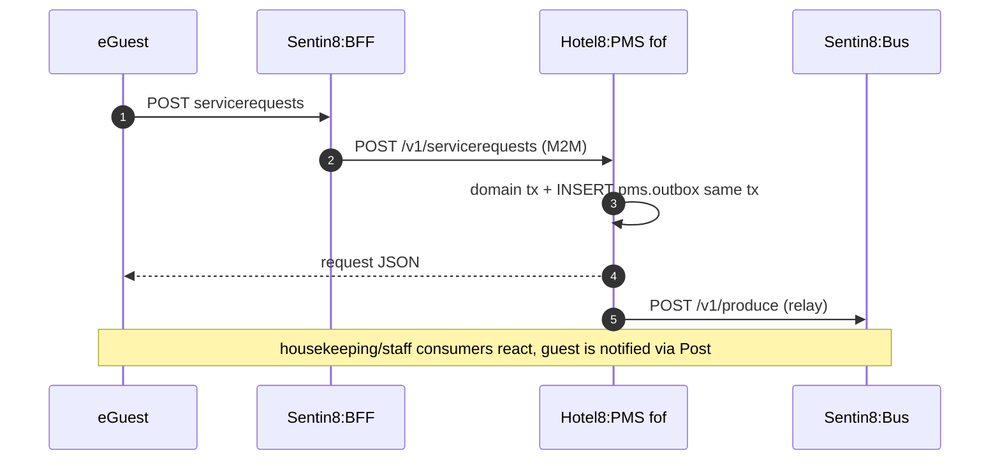

## 5. Cross-Cutting Concerns

- **Authentication:** guest sessions are BFF-held (customer env); the app
  sends cookies only. Stay access is scoped server-side to the guest's own
  reservations.
- **Tenant resolution + RLS:** resolved by the BFF; guest-visible PMS rows are
  RLS-tiered (holder-scoped `guest_id` records).
- **Idempotency & exactly-once:** key activation, check-in, check-out are
  server-side transactions with domain state transitions; a repeated tap
  cannot double-activate (the PMS validates state preconditions).
- **Audit:** mutations journal in PMS; the app adds nothing.
- **Rate limiting / bot protection:** edge-level; relevant for offer-accept
  spam, enforced server-side.
- **TLS posture:** Sentin8:TLS-terminated origins; dev HTTP fallback only for
  native localhost.
- **Upgrade drain:** stateless client.

## 6. Failure Modes & Recovery

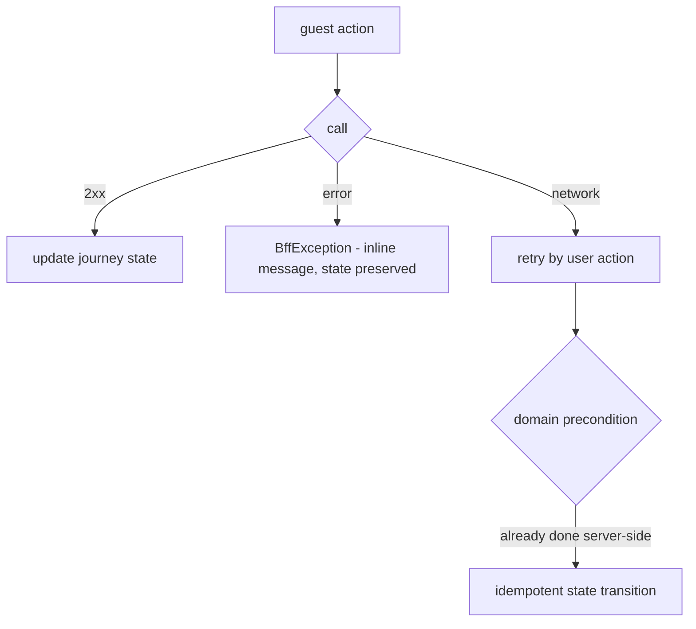

- **Key activation conflicts:** server validates key state; an already-active
  key re-activation returns the current state, the UI shows it.
- **Offer accept after expiry:** the Upsell lifecycle rejects stale offers
  with a clear error.
- **Payment declines:** folio remains open; guest can retry or switch
  method; check-out only succeeds after a covered folio.
- **Stale journey data:** every screen refetches on entry - no cached stay
  snapshot can mask a room change.

## 7. Concurrency & Performance Model

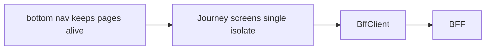

- Single isolate; async per action; messaging screen is the most chatty
  (polling the message list on entry/refresh).
- No local cache; folio and key state are too sensitive to render stale.
- One `http.Client` closed by the shell.

## 8. Invariants, Insecure-Defaults Rejected, Unsafe Rationale

**Invariants (always true):**

1. All paths are `/proxy/*`; stay-scoped calls always carry the stay id.
2. Non-2xx ⇒ `BffException`; no raw-status branching in screens.
3. Key state flips only via the PMS endpoints; the client never marks a key
   active/expired locally.
4. Folio/payment math is server-computed; the client renders.
5. No card data, tokens, or secrets in the app; payment outcomes arrive as
   Bill8 results.
6. Models request/response pairs are defined for every mutating flow
   (`PreCheckInRequest`, `CheckInRequest`, `CheckOutRequest`).

**Insecure defaults rejected:** anonymous "current stay" assumptions; keys
rendered from local optimistic state; direct PMS reads from the app; storing
folio snapshots across sessions.

**Unsafe code:** none.

## 9. Testing Strategy

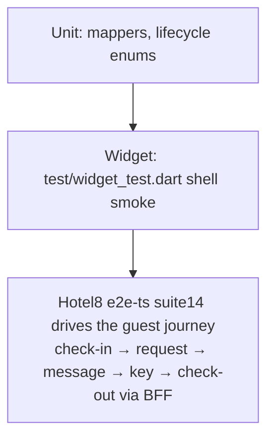

- **Unit** - mappers and lifecycle enum rendering.
- **Widget** - shell and navigation.
- **E2E** - the `e2e-ts` guest-journey specs cover check-in flow, service
  request, messaging, and check-out through the browser + BFF; deliberately
  NOT tested here: PMS domain logic, RLS tiers, upsell pricing (owned by
  the services).

## 10. Open Questions

- Push notification deep links (room ready, request completed): the
  notification contract is delivered - the app resolves deep-link routes
  (`/stay/{id}/room-ready`, `/stay/{id}/request/{rid}`) from the landing URL;
  the remaining piece is the Sentin8:Post push-credential provisioning for
  mobile installs (web gets in-app toasts already).
- BLE/NFC lock vendor integration path for mobile keys; the PMS digital-key
  routes exist (issue/activate/deactivate); physical lock handoff is the
  vendor layer.

---

**Architecture & Design:** hotel8:eguest and its underlying concepts were designed by [Hamid Jahanzad](https://www.linkedin.com/in/hamidjahanzad/).

