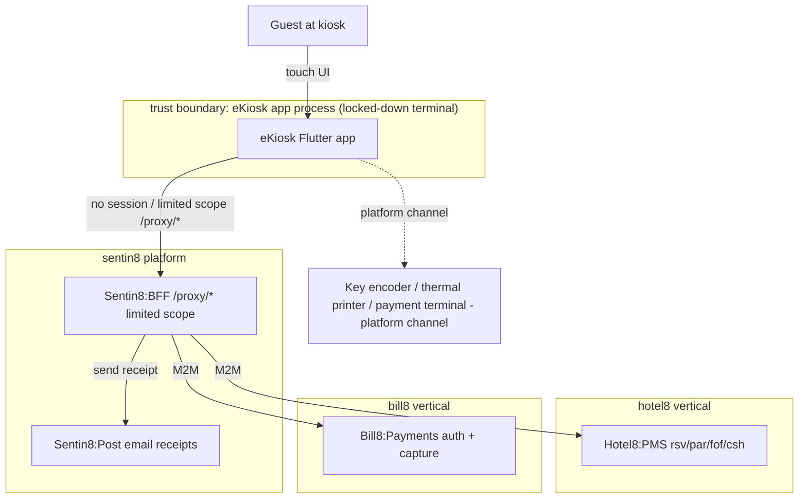
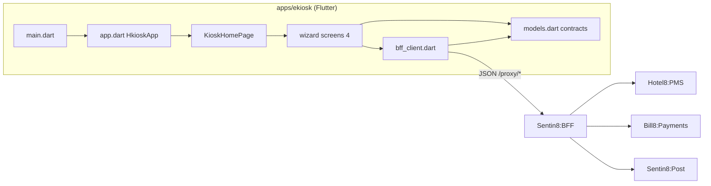
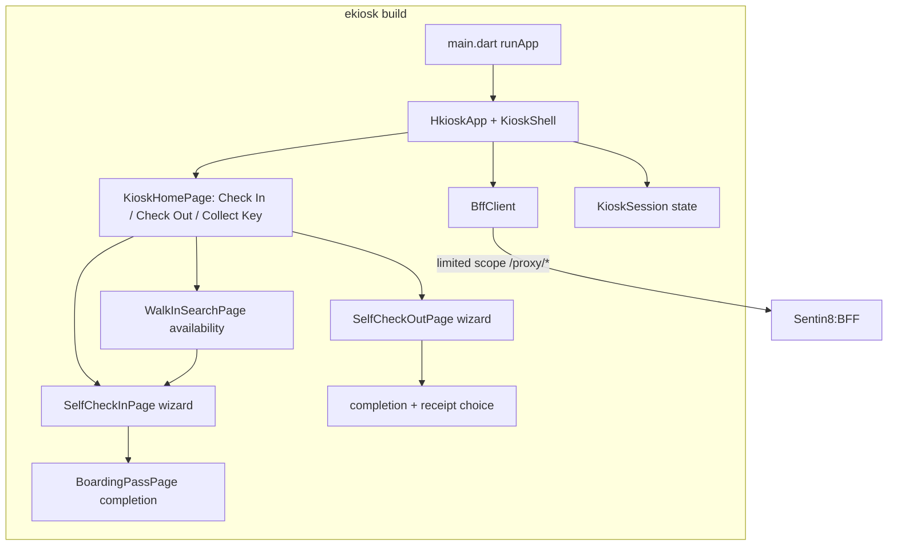
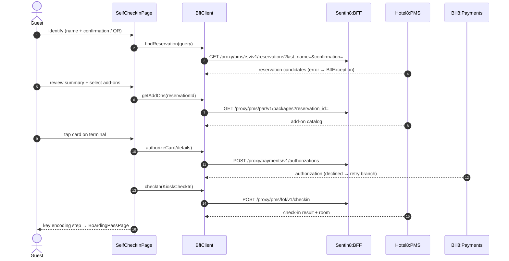
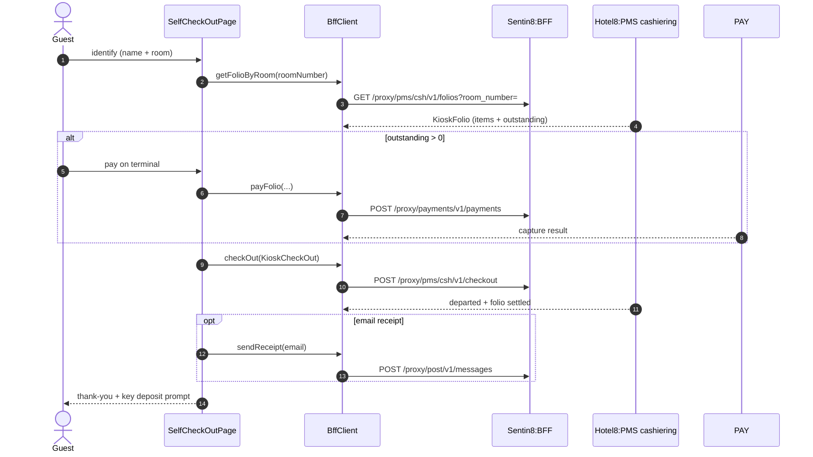
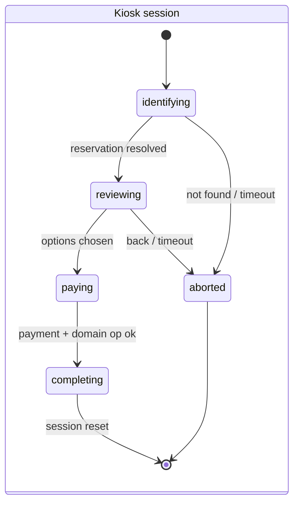
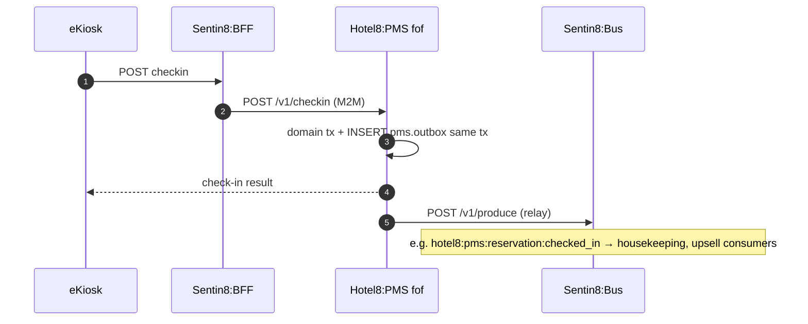
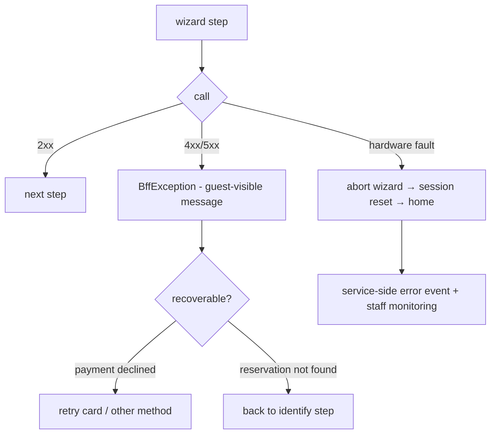
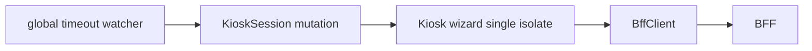
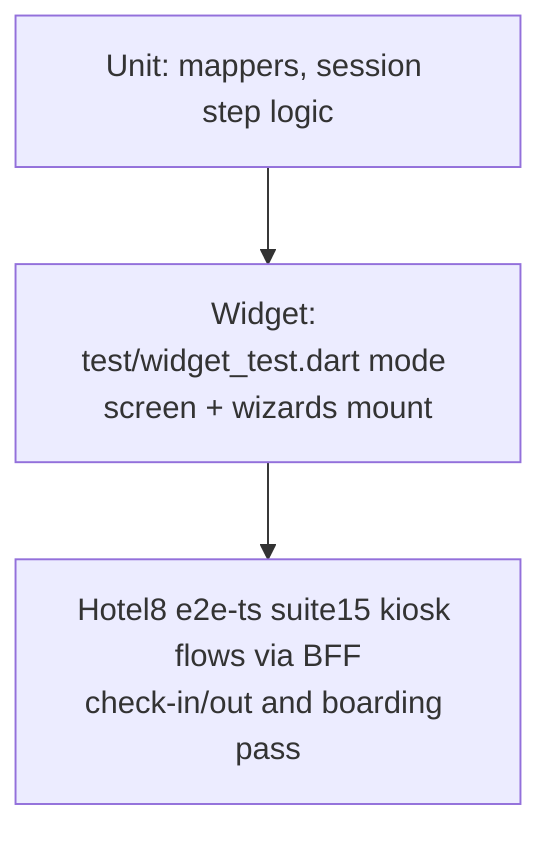

# DESIGN.md: Hotel8:eKiosk - Detailed Design Document

## 1. Scope & Context

**Owned by the eKiosk app:**

- The kiosk terminal UX: mode selection (driven by the property's
  `kiosk-config` row), self check-in wizard (identify → summary → add-ons →
  payment → key), self check-out wizard (identify → folio review → payment →
  receipt), walk-in search + express booking, lockdown freeze, and
  boarding-pass/key-collection flow.
- The client-side contract layer (`lib/models.dart`) for kiosk sessions,
  self-service reservations, add-ons, folios, and boarding passes.
- The BFF proxy call surface for the kiosk (`lib/bff_client.dart`).

**Explicitly NOT owned (consuming/delegating):**

| Concern | Owner |
|---|---|
| Reservation lookup, check-in, keys, folio, check-out | Hotel8:PMS (rsv/par/fof/csh) |
| Card authorization + capture | Bill8:Payments (via BFF) |
| Email receipts | Sentin8:Post (via BFF) |
| Add-on/pricing catalog | Hotel8:PMS packages (+ Upsell offers in future) |
| Key-encoding hardware | Kiosk platform channel + vendor SDK (deployment concern) |
| Thermal printing hardware | Kiosk platform channel |
| Payment terminal hardware | Vendor terminal behind the Payments proxy |
| Staff-side kiosk monitoring | Hotel8:ePMS |
| Lockdown mode / kiosk OS | Deployment platform (not the Flutter app) |
| Authorization decision, token custody | Sentin8:Auth + Shield (BFF-guarded, limited-scope) |

### System context



### Container view



## 2. Runtime Architecture



- `main.dart` / `app.dart` - entry + `HkioskApp` shell; owns the single
  `BffClient` and the current `KioskSession`.
- `screens/*.dart` - the mode-selection home and four wizard screens; each
  wizard completes or aborts back to home (session reset).
- `models.dart` - session, reservation, add-on, folio, boarding-pass
  contracts.
- `bff_client.dart` - typed kiosk endpoints (incl. `getKioskConfig` and
  `createWalkInBooking` - the terminal-config read and walk-in express
  booking).

### Request lifecycle - self check-in



### Request lifecycle - self check-out



## 3. Data Model

No persistence in the app; sessions are per transaction. Client projections:

```mermaid
erDiagram
    KIOSK_SESSION ||--|| SELF_SERVICE_RESERVATION : "resolves"
    SELF_SERVICE_RESERVATION ||--o{ ADD_ON : "attaches"
    SELF_SERVICE_RESERVATION ||--|| KIOSK_CHECK_IN : "checked in as"
    SELF_SERVICE_RESERVATION ||--|| KIOSK_CHECK_OUT : "checked out as"
    KIOSK_CHECK_OUT ||--|| KIOSK_FOLIO : "settles"
    KIOSK_FOLIO ||--o{ KIOSK_FOLIO_ITEM : "lists"
    KIOSK_SESSION ||--o|| BOARDING_PASS : "completes with"
    WALK_IN_SEARCH ||--o{ WALK_IN_ROOM : "finds"
```

State machines rendered by the wizards (authority in PMS/Payments):



Notes: `KioskMode` selects the wizard; `KioskCheckIn`/`KioskCheckOut` carry
the step outcomes (room, amount, add-on codes) the boarding pass renders.
`KioskFolioItem` types mirror the folio charge categories (room, tax, F&B,
mini bar, other). The mode menu and add-on list come from the property's
`kiosk-config` row (`pms DESIGN.md` §3 "Staff & corporate surfaces") - the
terminal never invents modes; `lockdown=true` freezes the terminal at the
attract loop with a staff-unlock notice (deployment owns the enclosure, the
app owns the freeze).

## 4. API Surface

All kiosk calls traverse the BFF with a limited-scope client. Audience:
self-service kiosk terminal. Paths as implemented in `bff_client.dart`:

| Group | Endpoints (method + proxy path) | Backend |
|---|---|---|
| Identify | `GET /proxy/hotel8-pms/v1/properties/{p}/reservations?last_name=&confirmation=`, `GET .../reservations/{id}` | Hotel8:PMS |
| Walk-in | `POST /proxy/hotel8-pms/v1/properties/{p}/availability` | Hotel8:PMS |
| Walk-in booking | `POST /proxy/hotel8-pms/v1/properties/{p}/walk-in` | express booking: creates a `CONFIRMED` reservation from the selected room type; the wizard then check-ins it (kiosk flow: search → book → check-in → keys) |
| Add-ons | `GET /proxy/hotel8-pms/v1/properties/{p}/packages` | Hotel8:PMS |
| Payment | `POST /proxy/bill8-payments/v1/payment-intents` (+`/{id}/confirm`) as authorization; `POST /proxy/bill8-payments/v1/charges` as capture | Bill8:Payments |
| Check-in | `POST /proxy/hotel8-pms/v1/properties/{p}/reservations/{id}/check-in` + `POST .../digital-keys` | Hotel8:PMS |
| Folio / check-out | `GET /proxy/hotel8-pms/v1/properties/{p}/folios?room_number=`, `POST .../reservations/{id}/check-out` | Hotel8:PMS |
| Receipt email | `POST /proxy/post/v1/send` | Sentin8:Post |
| Boarding pass | `GET /proxy/hotel8-pms/v1/properties/{p}/reservations/{id}/boarding-pass` | Hotel8:PMS |
| Terminal config | `GET /proxy/hotel8-pms/v1/properties/{p}/kiosk-config` | mode menu source of truth (`enabled_modes`, add-ons, `max_keys_per_stay`, `lockdown`) - the bootstrap read gates the journeys; hotel8:PMS kiosk-config row |

### Event flow

The app emits no events. The kiosk journeys produce PMS domain events
(check-in/out, payment, add-on purchase) and hardware-error events surface
through the service-side kiosk event family; the outbox→Bus→trigger chains
belong to Hotel8:PMS (`services/pms/DESIGN.md` §4).



## 5. Cross-Cutting Concerns

- **Authentication:** the kiosk holds a limited-scope BFF client (no guest
  session); each wizard step is authorized by that narrow scope set
  downstream.
- **Tenant resolution + RLS:** the BFF resolves env from the kiosk's
  registration/host; guest data is RLS-scoped server-side.
- **Idempotency & exactly-once:** check-in/out and payment capture are
  server-side transactions; double-taps fold onto one domain outcome.
- **Audit:** PMS journals check-in/out, payments and key operations; kiosk
  identity (device) is part of the audit context downstream.
- **Rate limiting / bot protection:** the terminal is on-property; edge rate
  limits still apply to the identification endpoints to resist enumeration -
  the wizard requires multiple identifiers for lookup.
- **TLS posture:** kiosk terminal traffic rides Sentin8:TLS origins.
- **Upgrade drain:** stateless single-terminal build; sessions abort on
  asset reload.

## 6. Failure Modes & Recovery



- **Payment decline mid-check-in:** the wizard returns to the payment step;
  the reservation is untouched until check-in executes.
- **Check-out with unclosable folio:** the wizard stops at the folio step;
  the guest is sent to the desk (server refuses partial check-out).
- **Session timeout:** every wizard returns home with a fresh session; guest
  data never persists between guests.
- **Key encoder failure:** server-confirmed check-in stands; issuance is
  retried at another kiosk or the desk (boarding pass can be printed or
  emailed depending on property config).

## 7. Concurrency & Performance Model



- Single isolate; one active wizard at a time; the session object is the only
  mutable state.
- Identification and availability calls are the hot path; payloads are small
  JSON; refetch per guest (no caching across sessions, by policy).
- One `http.Client` for terminal lifetime.

## 8. Invariants, Insecure-Defaults Rejected, Unsafe Rationale

**Invariants (always true):**

1. The kiosk client never holds a guest identity beyond one wizard session;
   completing or aborting resets it.
2. All money movement is Payments-proxy driven; folio/cashier outcomes are
   PMS-confirmed before the wizard advances.
3. Keys are dispensed only after server-confirmed check-in/identity flow;
   the client cannot force issuance.
4. Every path is `/proxy/*`; non-2xx ⇒ `BffException`.
5. Lookups require multiple identifiers (name + confirmation or name + room)
  - no single-field enumeration.

**Insecure defaults rejected:** guest accounts at the kiosk; persistent
across-guest session state; client-side payment confirmation (render-only);
single-identifier reservation lookup; card data in the app.

**Unsafe code:** none.

## 9. Testing Strategy



- **Unit** - mappers and session step transitions.
- **Widget** - home modes and wizard mounting.
- **E2E** - the `e2e-ts` kiosk specs drive check-in/out through the browser +
  BFF; hardware steps are out of scope for web E2E; deliberately NOT tested
  here: PMS check-in domain rules, payment capture internals (service-owned).

## 10. Open Questions

- Deployment target for hardware channels (payment terminal, encoder,
  printer) - which platform build ships first, and does the web build remain
  the only target for E2E? (The channel contract mirrors ePOS
  `h8pos_hardware` - `lib/hardware.dart`.)
- Lockdown enclosure ownership (kiosk OS / physical case) - the app-side
  freeze (`lockdown=true` → attract-loop freeze with staff-unlock notice) is
  implemented; the enclosure side is the deployment platform's concern.
- Paid walk-in settlement terms (deposit vs full charge at booking) - the
  walk-in booking + check-in flow is implemented; settlement policy defaults
  to card guarantee and a full folio at check-out.

---

**Design attribution:** hotel8:ekiosk and its underlying concepts were designed by Hamid Jahanzad <Hamid@Jahanzad.com>.

