# DESIGN.md: Hotel8:ePMS - Detailed Design Document

## 1. Scope & Context

**Owned by the ePMS app:**

- The staff console UX: dashboard, reservation search/detail/create, room
  status grid, check-in/out wizard, folio view (charges/payments), rate
  plans + schedules, blocks, profiles (CRM), EOD dashboard + exceptions,
  audit-log view, and the RFW-hosted operations pages.
- The runtime bootstrap: runtime-context resolution, staff auth provider,
  and the tenant→property identity threading.
- The RFW rendering host and the native widget-host registry.
- The client-side contract layer (`lib/models.dart`) and proxy client.

**Explicitly NOT owned (consuming/delegating):**

| Concern | Owner |
|---|---|
| Reservations, rooms, rates, inventory, folios, blocks, events, profiles, EOD domain logic | Hotel8:PMS (staff-scope endpoints) |
| RFW page definitions + admin data/submit endpoints | Hotel8:PMS admin surface (`/v1/admin/ui/*`, `/v1/admin/*`) |
| Staff identity, role scopes, authorization decision | Sentin8:Auth + Shield (BFF-guarded) |
| Payments/folio settlement | Hotel8:PMS → Bill8 (server-side) |
| Distribution channels | Hotel8:Distrib (via Dash - not in-app) |
| Guest-facing surfaces | Hotel8:eGuest / eBooking |
| POS terminal | Hotel8:ePOS |
| Upsell offer management UI | RFW admin (upsell service) via Dash |
| App store listing, DCR bootstrap | Sentin8:App + Sentin8:Auth |

### System context

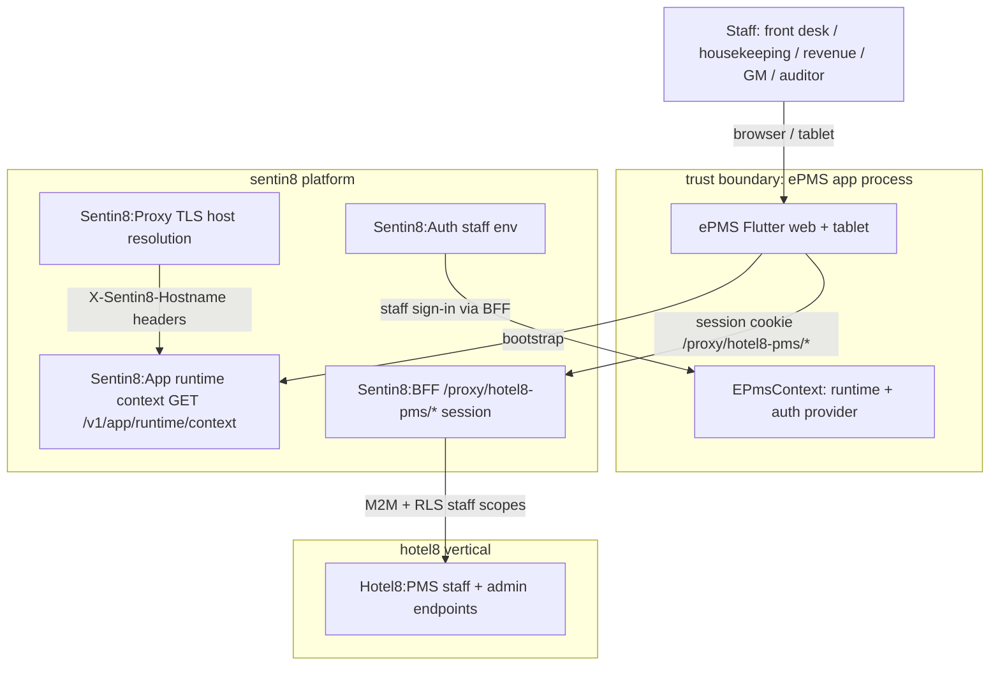

### Container view

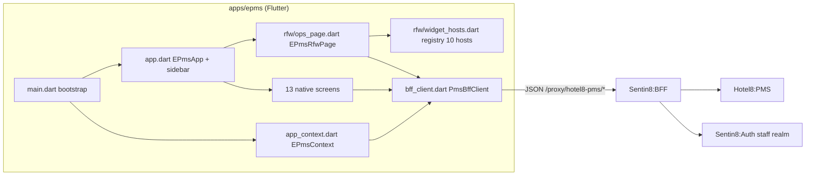

## 2. Runtime Architecture

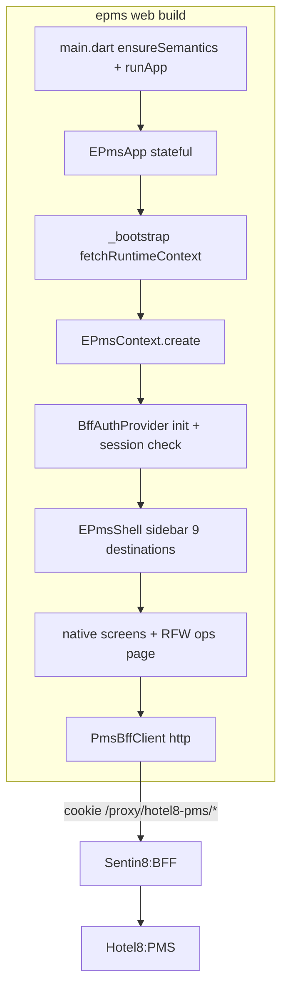

Bootstrap lifecycle (`main.dart`): `WidgetsFlutterBinding.ensureInitialized`
→ semantics on → `fetchRuntimeContext(appBaseUrl: '')` (same-origin so TLS
injects `X-Sentin8-Hostname`) → `EPmsContext.create(ctx)` (auth provider
init, session check) → render shell; bootstrap failure renders an error
screen with the message.

Component responsibilities:

- `app_context.dart` - runtime context + auth provider + client construction;
  `InheritedWidget` provider; notifies on auth changes.
- `app.dart` - sidebar shell (9 destinations: dashboard, reservations, room
  status, folio, rate plans, blocks, profiles, EOD, RFW ops) + the native
  pages switch + RFW route routing.
- `screens/screens.dart` - the native screen catalog (13 pages).
- `rfw/ops_page.dart` - RFW page host (`EPmsRfwPage`): fetch → cache (memory)
  → render → data/submit dispatch → navigation callback.
- `rfw/widget_hosts.dart` - the 10-entry native widget registry.
- `models.dart` - staff contract projections.

### Request lifecycle - bootstrap and session

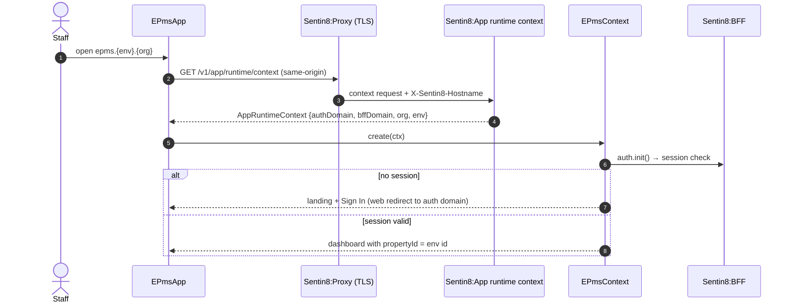

### Request lifecycle - staff mutation (check-in)

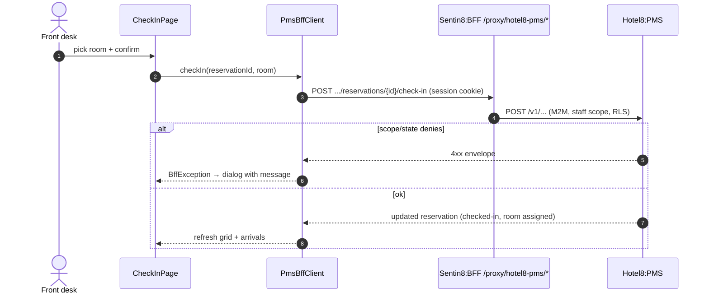

### Request lifecycle - RFW operations page

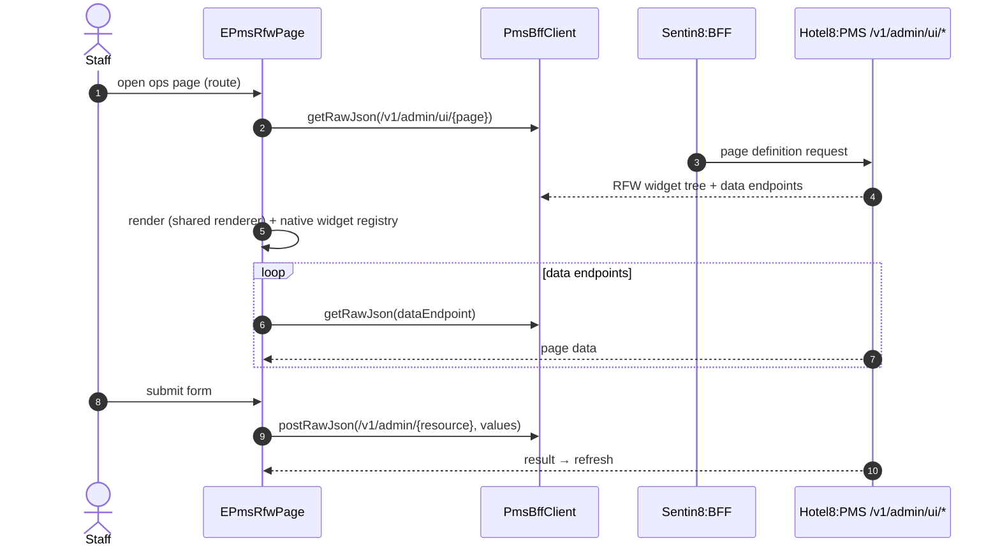

## 3. Data Model

No persistence. Staff projections of PMS tables (authoritative rows, state
machines, and RLS tiers: `services/pms/DESIGN.md` §3):

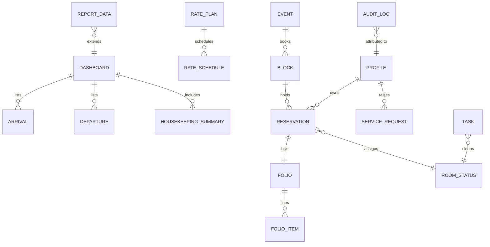

- `Reservation` carries the staff-facing lifecycle and actions the console
  can trigger (check-in/out, cancel, split, pre-check-in).
- `RoomStatus` is the housekeeping/front-office grid cell status.
- `Folio/FolioItem` distinguish charges/payments; posting goes through the
  folio charge/payment endpoints.
- `AuditLog` renders the property audit stream (read-back through the PMS
  audit-log endpoint).
- `Dashboard` aggregates occupancy, arrivals/departures, housekeeping and
  revenue stats for the landing page.

## 4. API Surface

All calls traverse the BFF (`/proxy/hotel8-pms/v1/properties/{propertyId}/...`)
with the staff session cookie; downstream authorization is the PMS
staff/admin scope set via Shield. Audience: hotel staff/property admin.
Paths as implemented in `bff_client.dart`:

| Group | Endpoints (method + proxy path suffix under the property root) | Purpose |
|---|---|---|
| Dashboard | `GET reports/occupancy` | front-desk landing stats |
| Reservations | `GET/POST reservations`, `GET/PUT reservations/{id}`, `PUT .../cancel`, `PUT .../split` | search, create, edit, cancel, split |
| Check-in/out | `PUT .../pre-check-in`, `PUT .../check-in`, `PUT .../check-out` | front-desk wizard |
| Housekeeping | `GET housekeeping`, `PUT housekeeping/{room}` | room status grid |
| Folio | `GET .../folio` (per reservation), `POST .../charges`, `POST .../payments` | cashiering |
| Rates | `GET rate-plans`, `GET rate-plans/{id}/schedules` | revenue management |
| Blocks & events | `GET blocks`, `GET events` | group and catering |
| Profiles | `GET profiles` | CRM lookup |
| EOD | `POST end-of-day`, `GET end-of-day/exceptions` | night audit |
| Availability | `GET availability`, `GET inventory` | allocation views |
| Audit | `GET audit-log` | property audit stream |
| RFW host | `GET /v1/admin/ui/{page}` + `/v1/admin/{resource}` data/submit (via `getRawJson`/`postRawJson`) | RFW-rendered ops pages |

### Event flow

The app emits no events; staff mutations trigger PMS domain events whose
chains are specified in `services/pms/DESIGN.md` §4 (outbox → Bus →
consumers such as POS room charge, upsell, distrib ARI).

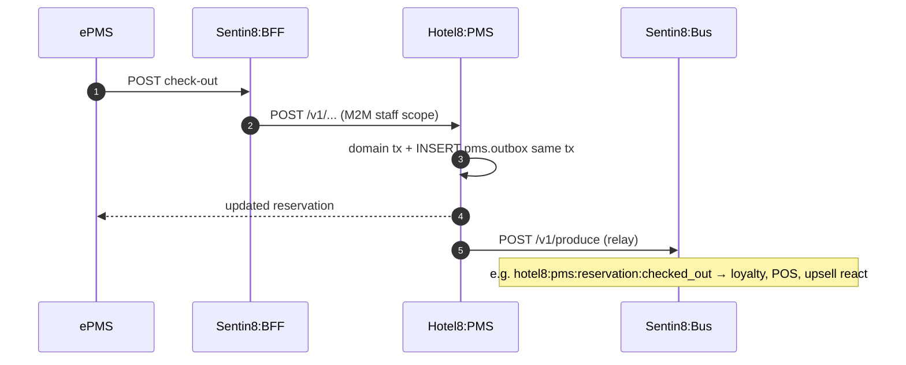

## 5. Cross-Cutting Concerns

- **Authentication:** staff sessions via the shared `BffAuthProvider` (staff
  realm); tokens stay in the BFF; the app works with the session cookie.
  Sign-in/out uses full web redirects to the auth domain.
- **Tenant resolution + RLS:** the runtime context supplies org/env; the BFF
  resolves tenant from session/host and enforces RLS downstream.
  `propertyId = environmentId` by tenant construction.
- **Idempotency & exactly-once:** staff actions are server transactions with
  state preconditions (e.g. check-in refuses a checked-in reservation);
  double-clicks cannot double-apply.
- **Role-based access:** page access and action availability are scope-gated
  server-side per endpoint; the console renders what the session can reach.
- **Audit:** PMS journals all staff mutations; the audit-log view is read-back
  only.
- **TLS posture:** served from Sentin8:TLS origins; runtime context and BFF
  calls ride the same TLS host headers.
- **Upgrade drain:** stateless SPA; reload picks up new assets; RFW definitions
  are refetched per mount (no stale surface).

## 6. Failure Modes & Recovery

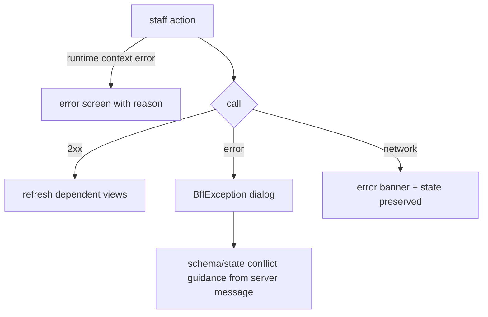

- **Bootstrap failure** (context/auth domain unreachable) surfaces an error
  screen listing the cause - the shell never renders half-initialized.
- **Mutation rejections** (scope, state preconditions) surface the server
  message; no client-side workaround paths exist.
- **RFW definition failure**: the host renders an error state for that page;
  other navigation remains usable.
- **Session expiry**: auth listener flips the shell to the sign-in flow on
  the next auth change.

## 7. Concurrency & Performance Model

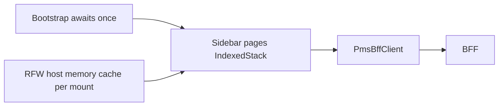

- Single isolate; async per action; screens refetch on entry; no global
  data store.
- Native screens are tuned for density (grids, lists); the RFW host pays a
  fetch-per-mount cost only for ops pages.
- One `http.Client` (cookie session) closed by the context's dispose.

## 8. Invariants, Insecure-Defaults Rejected, Unsafe Rationale

**Invariants (always true):**

1. Every API path lives under `/proxy/hotel8-pms/v1/properties/{propertyId}`;
   no other service is called directly in-app.
2. `propertyId` originates from the resolved runtime context - never
   user-editable input.
3. RFW definitions are fetched per mount; the host never renders a stale
   cached definition across property switches.
4. Widget hosts are logic-free UI primitives wired by props +
   `onValueChanged` + RFW-declared data endpoints.
5. Tokens never enter the app; auth is the BFF session cookie.
6. Auth state changes always flow through the listener (no polling).

**Insecure defaults rejected:** property id from user input; direct PMS
service URLs; tokens in web storage; persistent RFW definition cache on disk.

**Unsafe code:** none (web build; no platform channels in this app).

## 9. Testing Strategy

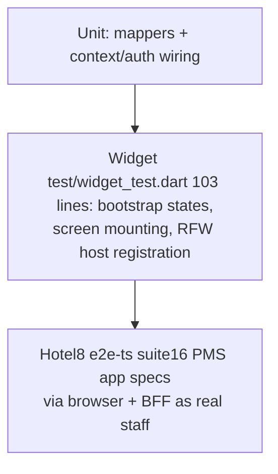

- **Unit** - model mappers, context creation, auth provider wiring.
- **Widget** - bootstrap loader/error/dashboard states, screen smoke-mounts,
  the RFW host with its widget registry.
- **E2E** - `e2e-ts` PMS app specs cover sign-in → dashboard → reservations
  → check-in/out → EOD through the browser + BFF; deliberately NOT tested
  here: PMS domain rules, RLS, RFW definition correctness (service-owned).

## 10. Open Questions

- Multi-property-per-env resolution (property registry read) vs the current
  `propertyId = environmentId` shortcut.
- RFW host caching with TTL validation and role-gated page access (hide
  pages outside the user's role) are designed-for but not implemented.
- Session re-auth UX for sensitive operations (timeout duration, scope
  elevation) pending the staff session policy.

---

**Design attribution:** hotel8:epms and its underlying concepts were designed by Hamid Jahanzad <Hamid@Jahanzad.com>.

