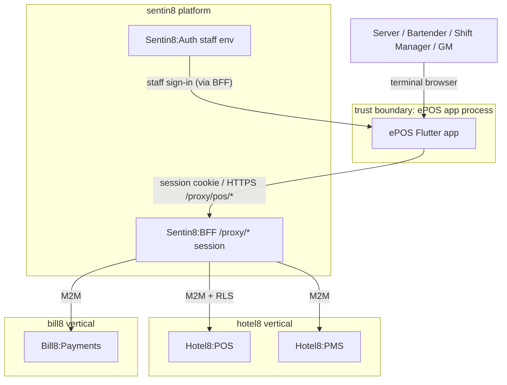
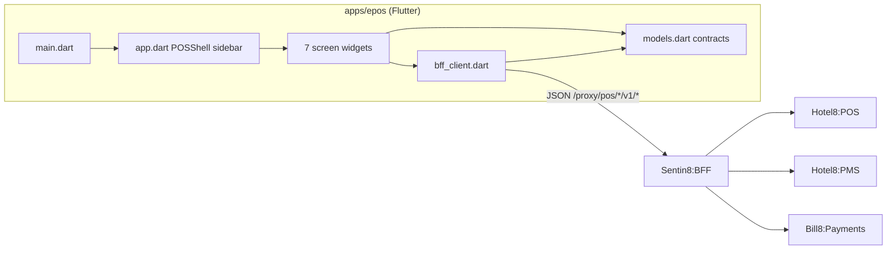
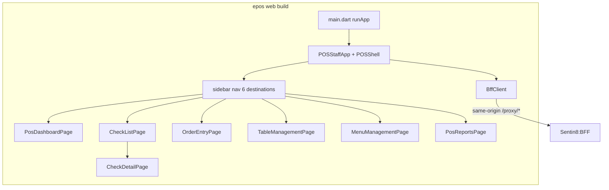
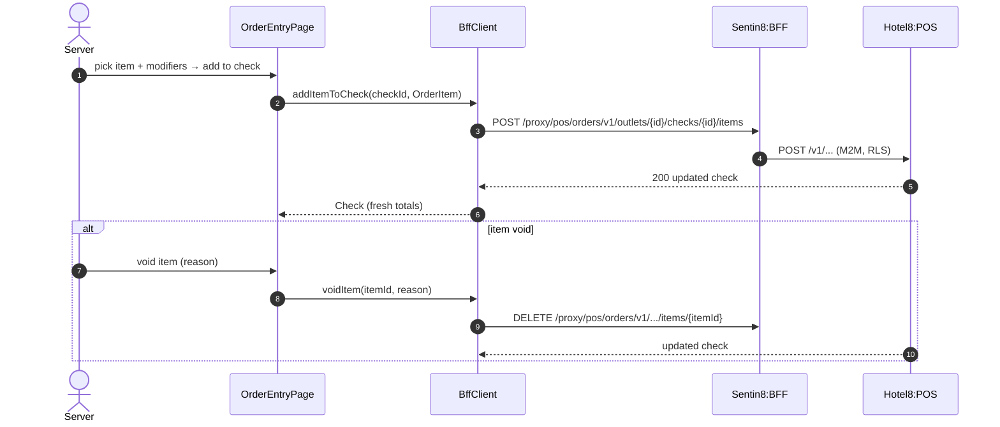
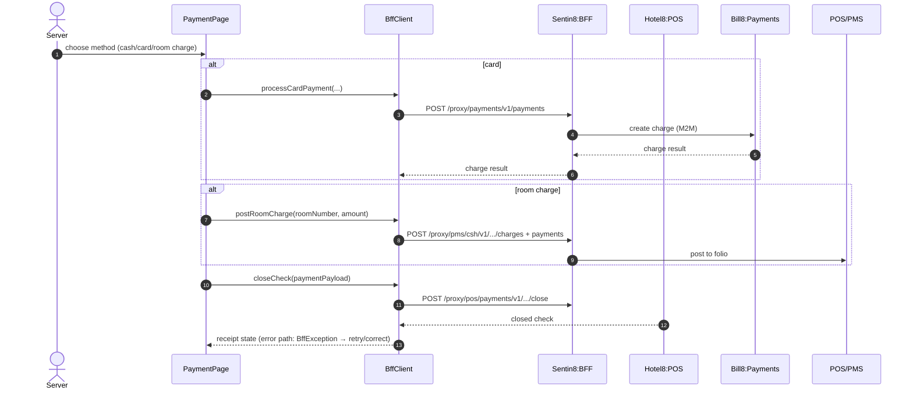
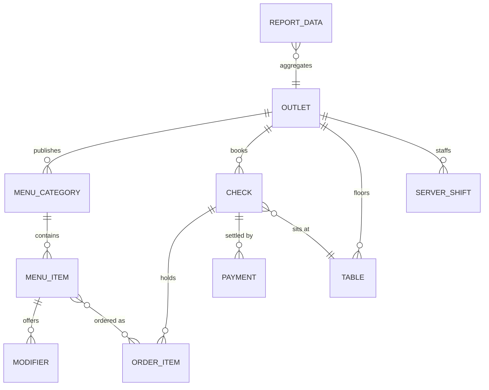
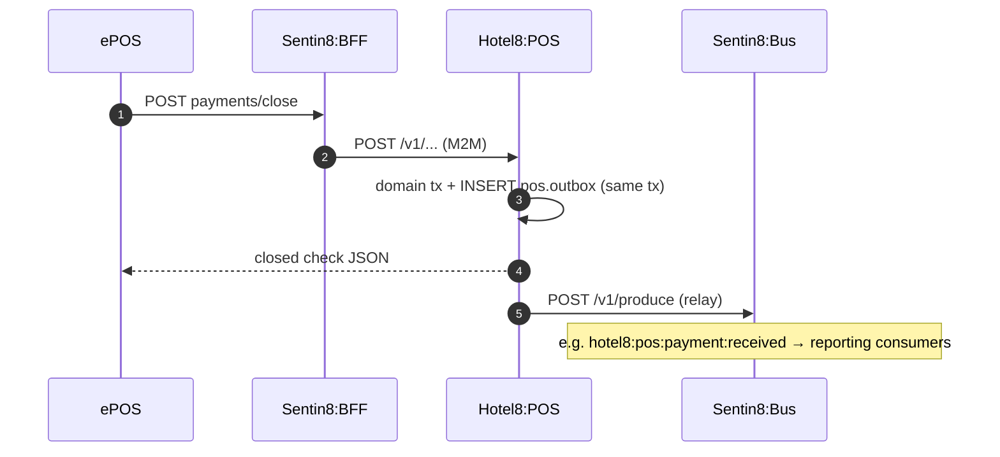
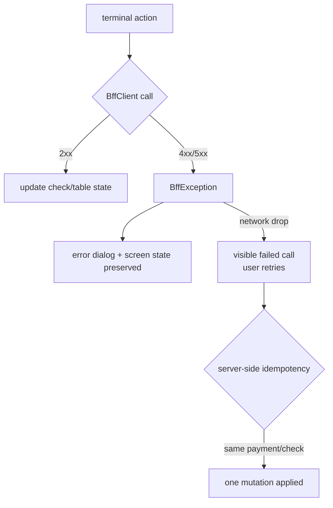
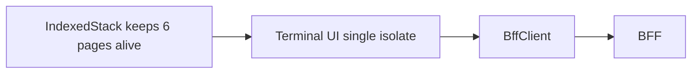
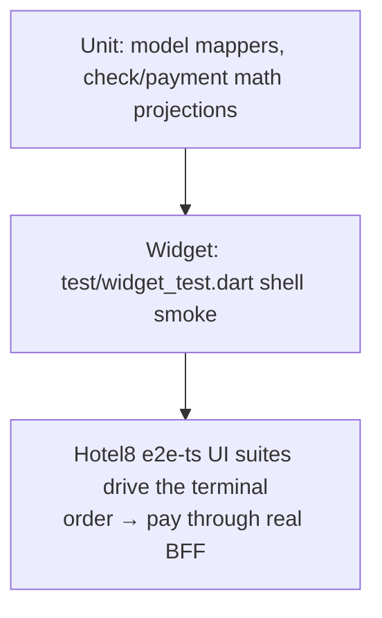

# DESIGN.md: Hotel8:ePOS - Detailed Design Document

## 1. Scope & Context

**Owned by the ePOS app:**

- The staff terminal user experience: dashboard, check list/detail, order
  entry, table management (floor plan), menu management (incl. 86'ing), and
  reports.
- The client-side contract layer (`lib/models.dart`) mirroring Hotel8:POS
  contract shapes.
- The BFF proxy call surface for the terminal (`lib/bff_client.dart`),
  including the PMS room-charge and Bill8 card-capture flows.

**Explicitly NOT owned (consuming/delegating):**

| Concern | Owner |
|---|---|
| Checks, orders, menus, tables, payments domain logic | Hotel8:POS |
| Card capture / settlement | Bill8:Payments (via BFF) |
| Room charge posting, guest profile lookup | Hotel8:PMS (via BFF) |
| Staff identity, role scopes, authorization decision | Sentin8:Auth + Shield (BFF-guarded) |
| Guest-facing menu browsing and ordering | Hotel8:eGuest |
| Reservation/front-desk operations | Hotel8:ePMS |
| Kitchen display & printer routing | Hotel8:POS printer groups (config only in-app) |
| App store listing, runtime context, DCR bootstrap | Sentin8:App + Sentin8:Auth |

### System context

### Container view

## 2. Runtime Architecture

Component responsibilities:

- `main.dart` - entry point.
- `app.dart` - `POSStaffApp` (Material theme, seed color) + `POSShell`
  (sidebar `NavigationBar`-style rail over `IndexedStack`, the outlet context,
  the single `BffClient`).
- `screens/*.dart` - screen widgets per terminal function; navigation pushes
  carry ids (check id, table id) rather than copying state.
- `models.dart` - immutable contract mappers for the POS domain.
- `bff_client.dart` - typed endpoint wrappers; error normalization.
- `offline_queue.dart` - offline order-capture + deferred settlement:
  network-class failures queue the op (client-side idempotency key) and the
  queue replays via `POST /v1/offline-sync` on reconnect (§6 offline
  terminal row); any successful call re-marks the terminal online.
- `hardware.dart` - the terminal-hardware surface (`h8pos_hardware`
  platform channel: `payTerminal`, `printReceipt`, `openDrawer`); the web
  build reports hardware unavailable instead of failing silently.

### Request lifecycle - order entry → payment

### Request lifecycle - payment close

## 3. Data Model

The app persists nothing. Client models are projections of Hotel8:POS tables
(authoritative rows and state machines: `services/pos/DESIGN.md` §3).

Notes:

- `Check` carries the payment state (`open` → `paid` / `void`) the UI filters
  on; voiding is item-level (with reason) or check-level.
- `Payment` covers cash, card, and room-charge variants; card specifics are
  Bill8 concerns, so the model holds only the outcome fields.
- `MenuItem.availability` is the 86 flag; toggling goes through the `86`
  endpoint so all terminals see it immediately.
- `Table.status` colors (available/occupied/reserved/dirty/OOS) drive the
  floor-plan view; changes are explicit seat/status calls.

## 4. API Surface

All calls traverse the BFF (staff-session cookie). Audience: staff terminal
(scope-gated downstream, e.g. `hotel8:pos:orders:write`). Paths as implemented
in `bff_client.dart`:

| Group | Endpoints (method + proxy path) | Backend |
|---|---|---|
| Outlets/dashboard | `GET /proxy/hotel8-pos/v1/outlets`, `GET .../outlets/{id}/reports/sales` | Hotel8:POS |
| Checks | `GET/POST /proxy/hotel8-pos/v1/outlets/{id}/checks`, `GET/PUT .../checks/{id}`, `POST .../void`, `.../transfer`, `.../split` | Hotel8:POS |
| Orders/items | `POST/DELETE /proxy/hotel8-pos/v1/outlets/{id}/checks/{cid}/orders[/{itemId}]` | Hotel8:POS |
| Payments | `POST .../checks/{cid}/payments`, `POST .../payments-process` (close) | Hotel8:POS |
| Card capture | `POST /proxy/payments/v1/payments` | Bill8:Payments |
| Room charge | PMS folio charge + payment proxy paths (`/proxy/pms/csh/v1/...`) | Hotel8:PMS |
| Tables | `GET/PUT .../outlets/{id}/tables[/{tableId}]`, `POST .../seat` | Hotel8:POS |
| Menu | `GET .../menu/categories`, `GET .../menu-items`, `PUT .../menu-items/{id}/availability` (86) | Hotel8:POS |
| Reports | `GET .../outlets/{id}/reports/{sales|items|labor|end-of-day}` | Hotel8:POS |

### Event flow

The app emits no events. The POS service owns the event chains its mutations
trigger - see `services/pos/DESIGN.md` §4 (outbox → Bus → consumers).

## 5. Cross-Cutting Concerns

- **Authentication:** staff sessions are BFF-held; the app presents a session
  cookie only. Role-based action gating (void/comp/discount approvals) is
  enforced server-side per endpoint.
- **Tenant resolution + RLS:** BFF resolves env and sets RLS downstream; the
  app passes no tenant identifiers.
- **Idempotency & exactly-once:** payment close and check mutations are
  single server-side transactions; the client retries visibly rather than
  silently duplicating (checks and payments are keyed server-side).
- **Rate limiting / bot protection:** edge-level at BFF/proxy; not a terminal
  concern.
- **Audit:** all payment/void/discount/comp mutations are audited by Hotel8:POS
  journaling; the client contributes the acting staff session only.
- **TLS posture:** terminal browsers run on Sentin8:TLS-terminated origins;
  dev HTTP fallback is native-only localhost.
- **Upgrade drain:** stateless terminal build - reload picks up new assets.

## 6. Failure Modes & Recovery

- **Payment failure mid-flow:** the check remains open with payments
  recorded; the terminal can re-attempt a different method; the server
  reconciles partials (pos service owns the payment rows).
- **Void/deny:** manager-approval rules live server-side; a 403 surfaces as a
  message, not a UI bypass.
- **Stale floor plan:** table and check lists are refetched on entry/refresh;
  no local mutation-only drift.

## 7. Concurrency & Performance Model

- Single isolate; async calls fire per user action; screens hold no locks.
- All six destination pages stay alive in an `IndexedStack` (fast tab
  switching, per-tab scroll state); heavy payloads are reports (bounded by
  date range via query).
- One `http.Client` for app lifetime; closed by the shell.
- Menu data is refetched per outlet entry - menu edits (86) must reflect
  immediately, so no menu cache.

## 8. Invariants, Insecure-Defaults Rejected, Unsafe Rationale

**Invariants (always true):**

1. Terminal paths are `/proxy/pos/{segment}/v1/...`; the only non-pos paths
   are the room-charge (PMS) and card-capture (Bill8) proxy calls inside the
   payment flow.
2. Non-2xx ⇒ `BffException`; no raw-status branching in screens.
3. Totals shown are server-provided; the client never recomputes money
   figures for decisions.
4. Outlet context is set once by the shell and immutable during a flow.
5. No card data enters the client; card flows are Bill8 token outcomes.

**Insecure defaults rejected:** client-side price recalculation as truth;
local offline payment queue before an approved platform offline pattern;
direct POS/PMS service URLs from the app; bypassing manager-approval
endpoints with UI-only gating.

**Unsafe code:** none.

## 9. Testing Strategy

- **Unit** - contract mappers and any future client-side projection helpers.
- **Widget** - shell renders navigation and dashboard; screens mount with
  injected clients.
- **E2E** - the hotel8 `e2e-ts` UI suites cover the terminal user journey
  through the browser + BFF exactly as a human would; deliberately NOT
  tested here: POS domain logic, RLS, event chains (owned by
  `services/pos` tests).

## 10. Open Questions

- Runtime-context bootstrap (outlet id, staff sign-in gate) - the terminal
  binds the property's first outlet; multi-outlet selection arrives with an
  outlet registry page (assignment is a property-level configuration).
- Hardware (payment terminal, printer group routing, drawer) integration via
  platform channels - `lib/hardware.dart` declares the channel contract
  (`h8pos_hardware`: `payTerminal`, `printReceipt`, `openDrawer`) and the
  web build reports hardware unavailable; which platform build ships first
  (kiosk-style Android/embedding targets vs web-only terminals) is the open
  deployment decision.

---

**Design attribution:** hotel8:epos and its underlying concepts were designed by Hamid Jahanzad <Hamid@Jahanzad.com>.

