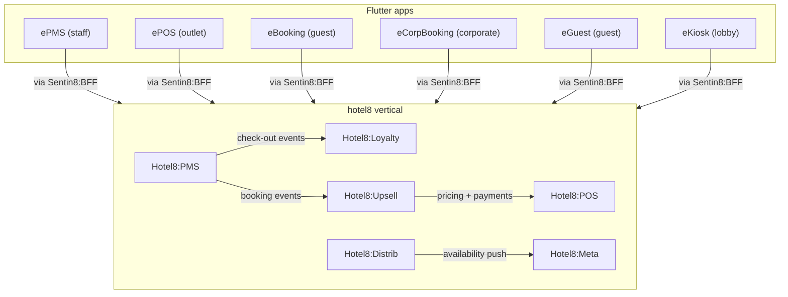

# Hotel8 - the hospitality vertical

Hotel8 is property management, point of sale, distribution,
metasearch, loyalty, and guest upsell composed on the Sentin8
platform: six Rust services that own the hotel8 database, a unified
Rust SDK facade, and six Flutter apps. It contains **no platform
infrastructure of its own** - identity, events, storage, scheduling,
workflows, and supervision come from the platform; money movement is
delegated to [Bank8:Payments](https://bank8.dev/docs/products/payments/).

## The products

| Product | Role |
|---|---|
| [PMS](/docs/products/pms) | property management - rooms, rates, reservations, front desk |
| [POS](/docs/products/pos) | food & beverage point of sale - checks, kitchen routing |
| [Upsell](/docs/products/upsell) | the offer engine - context-appropriate guest offers |
| [Distrib](/docs/products/distrib) | channel distribution - OTA/GDS/wholesale connectivity |
| [Meta](/docs/products/meta) | metasearch - Google Hotel Ads, Trivago, Kayak |
| [Loyalty](/docs/products/loyalty) | the guest loyalty engine - programs, tiers, points |

## Security

Hotel8 inherits the platform's five pillars and adds hospitality
guarantees: property truth in one place, channel parity without
leaks, payments delegated never duplicated, and deterministic
loyalty. Read the [security page](/docs/security).