# Hotel8:Distrib - Detailed Design Document

## 1. Scope & Context

**Owned by Distrib:** database `hotel8`, schema `distrib` - 12 tables
(`distrib.channels`, `channel_properties`, `room_type_mappings`,
`rate_plan_mappings`, `rate_updates`, `inventory_updates`, `bookings`,
`sync_log`, + `distrib.channel_type` / `distrib.sync_status` enums +
`distrib.outbox` / `distrib.audit_journal`); event family `distrib`; the
ARI-republication direct consumer; RFW admin pages.

**NOT owned:** room inventory/rates truth (hotel8:pms), actual reservation
state in-house (hotel8:pms holds it via received bookings), identity (Auth),
delivery of channel payloads (the channels are external systems - Bus events
describe business facts; transport contracts are per-channel integration).

### System context

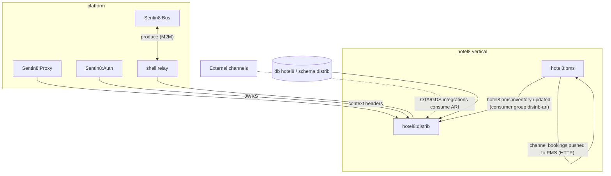

### Container view

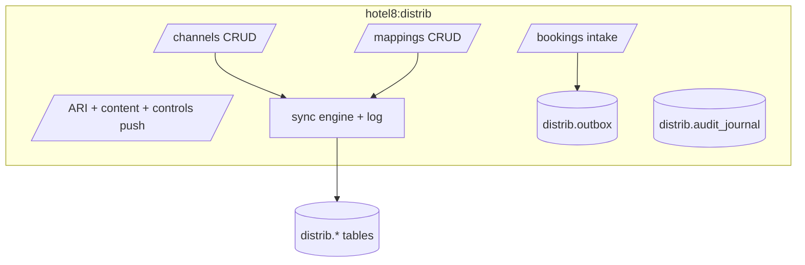

## 2. Runtime Architecture

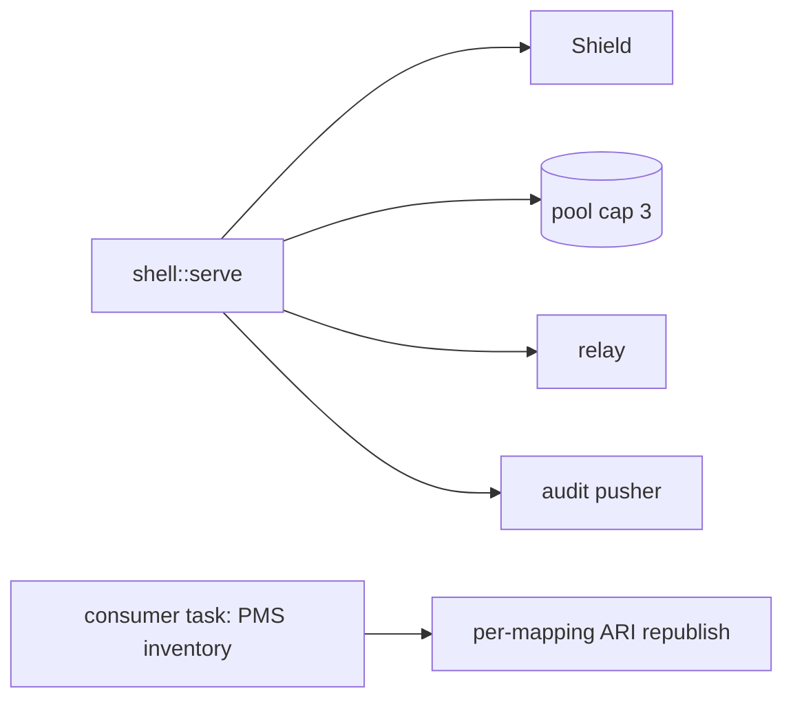

### Request lifecycle - ARI push

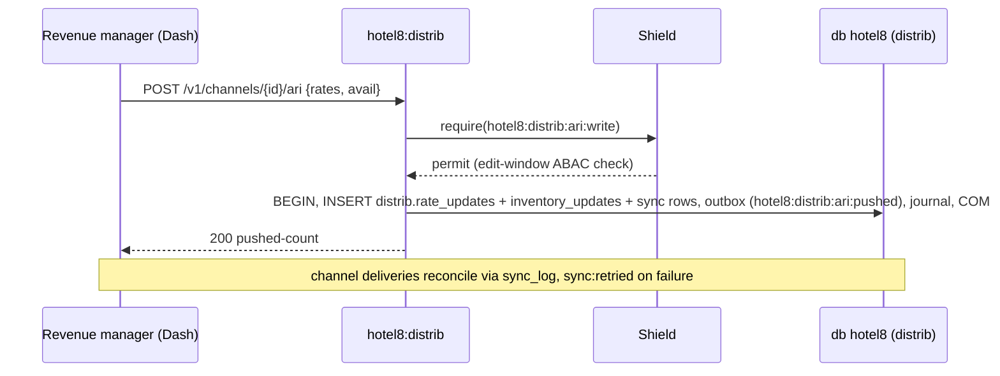

### Request lifecycle - channel booking intake

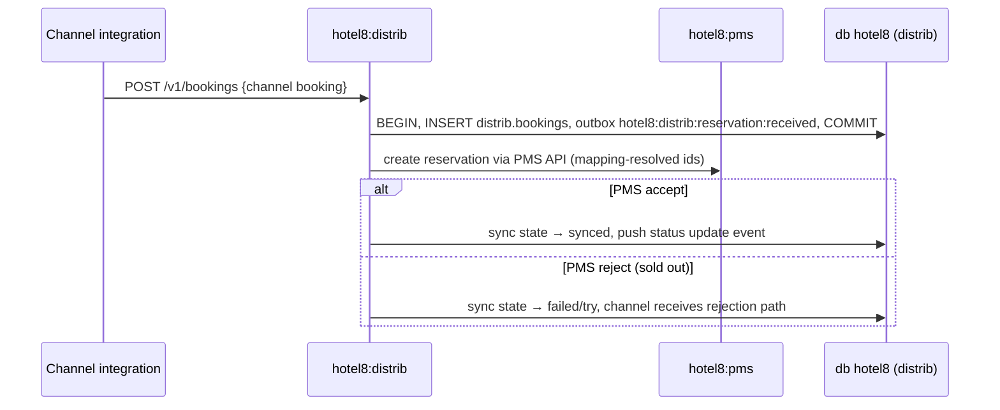

## 3. Data Model

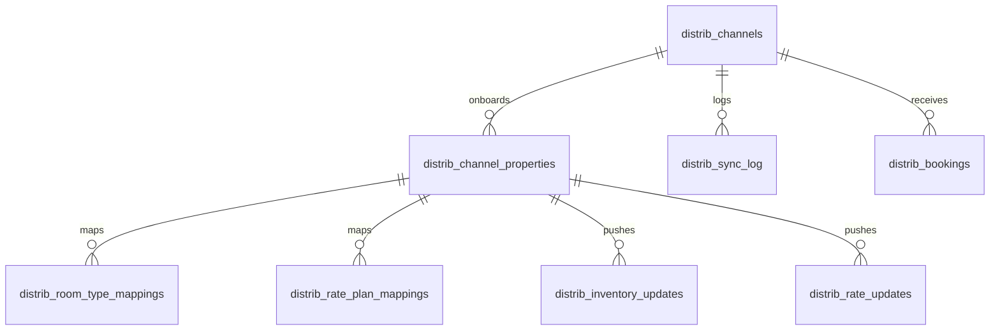

- `channel_type`: OTA/GDS/DIRECT/WHOLESALER/CORPORATE/METASEARCH (enum).
- `sync_status`: pending/synced/failed/retry (enum) - the SyncState machine
  mirrors it.
- All env-scoped + FORCE-RLS; audit journal included; channel secrets are
  NOT stored here (meta owns channel credentials).

### State machine - sync

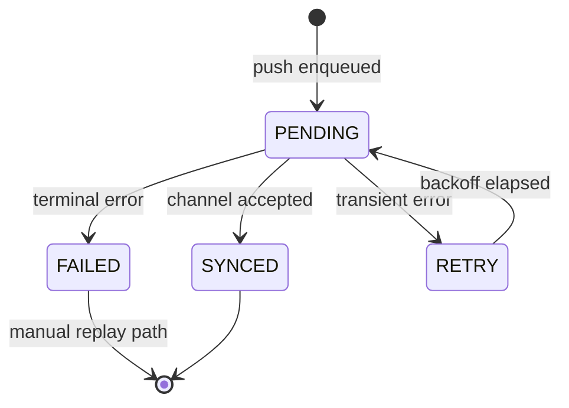

## 4. API Surface

**Public** (`hotel8:distrib:{read,admin,ari:write}` scope mirror):

- Channels CRUD (`channel:created/updated/deleted`).
- Channel-property onboarding; room-type/rate-plan mappings.
- Rate markup/markdown configuration (`rate_markup:set`).
- ARI + content + controls push (`ari:pushed`, `content:pushed`,
  `controls:pushed`, `controls:set`).
- Reservation intake + status pushing (`reservation:received/updated/
  status_pushed`); sync replay (`sync:retried`).

**Admin/RFU**: RFW pages + shared policy admin (per-channel ARI edit
windows as ABAC; channel-partner edges as ReBAC).

### Cross-service data access - decision order (membus → bus → owner API)

ARI fan-out is event-first: `hotel8:pms:inventory:updated` (consumer group
`distrib-ari`) re-maps availability per channel - the bus path. Owner-API
residuals are synchronous request/response that must return a value:
channel booking intake pushes reservations into PMS (`create_reservation` -
the caller needs the confirmation number), ARI pull reads the 30-day
inventory window (`get_inventory`), cancellations propagate
(`cancel_reservation`). MemBus: none (channel sync is horizon-scoped, not
tick-scoped). No pms-schema grant; PMS gains no distrib tables either.

### Event flow

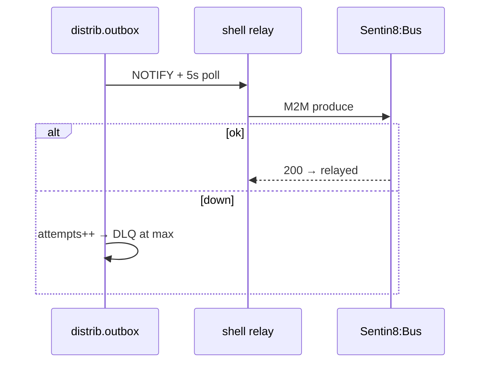

## 5. Cross-Cutting Concerns

- Auth/tenant/RLS/audit/drain/TLS/pool follow the platform contract (same
  shell construction as the other hotel8 services).
- Channel-facing integrations authenticate as channel M2M identities with
  `hotel8:distrib:admin` scoped grants; booking intake is validated at the
  Shield layer before any mapping resolution.

## 6. Failure Modes & Recovery

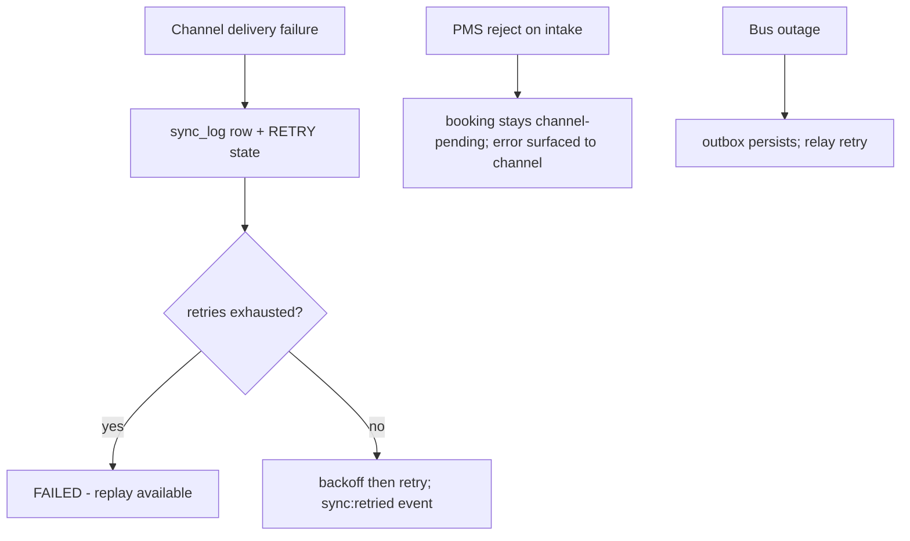

## 7. Concurrency & Performance Model

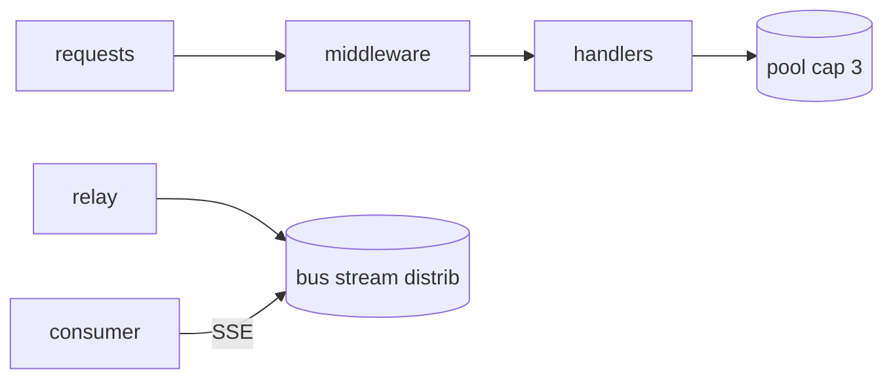

- Hot path: ARI republish from PMS inventory events - batch per channel
  property from a single event; channel delivery is downstream of the
  outbox, never inline.

## 8. Invariants, Insecure-Defaults Rejected, Unsafe Rationale

- Every mapping resolves both sides before any push; unresolved mappings
  cannot produce ARI.
- A received booking always has its channel attribution and a sync row
  recording the delivery outcome.
- Rate updates are append-only facts; markups never mutate history.
- No `unsafe`; no platform-DB access; channel secrets are by-reference
  (hotel8:meta owns them).
- Insecure defaults rejected: no unsigned channel intake; no cross-channel
  read authority.

## 9. Testing Strategy

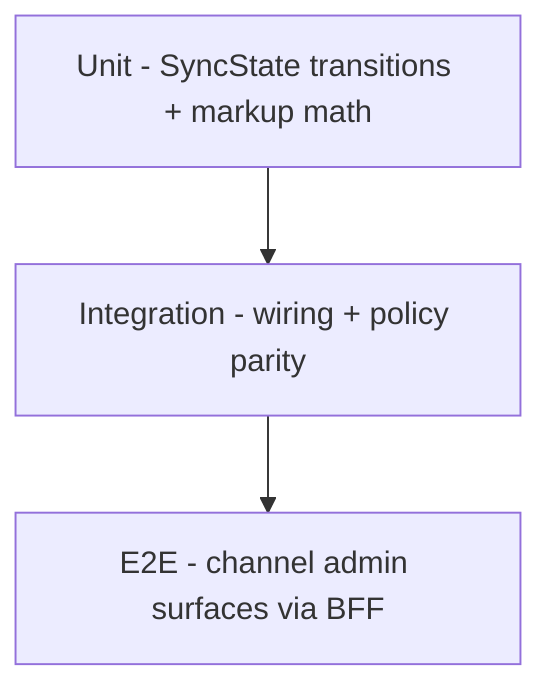

## 10. Open Questions

- Two-way content sync.
- Rate-parity anomaly detection.

---

**Design attribution:** hotel8:distrib and its underlying concepts were designed by Hamid Jahanzad <Hamid@Jahanzad.com>.

