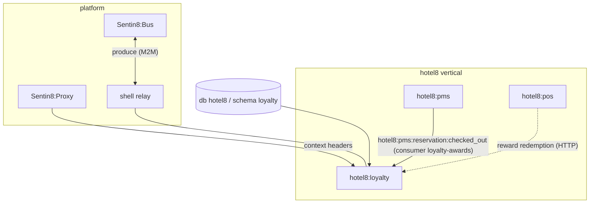
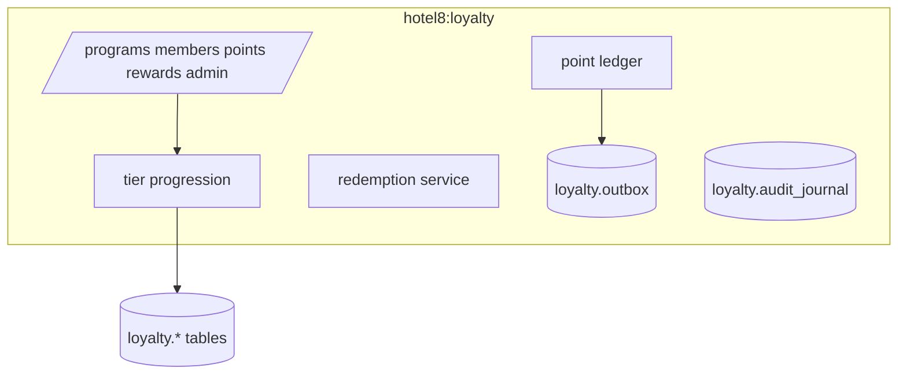
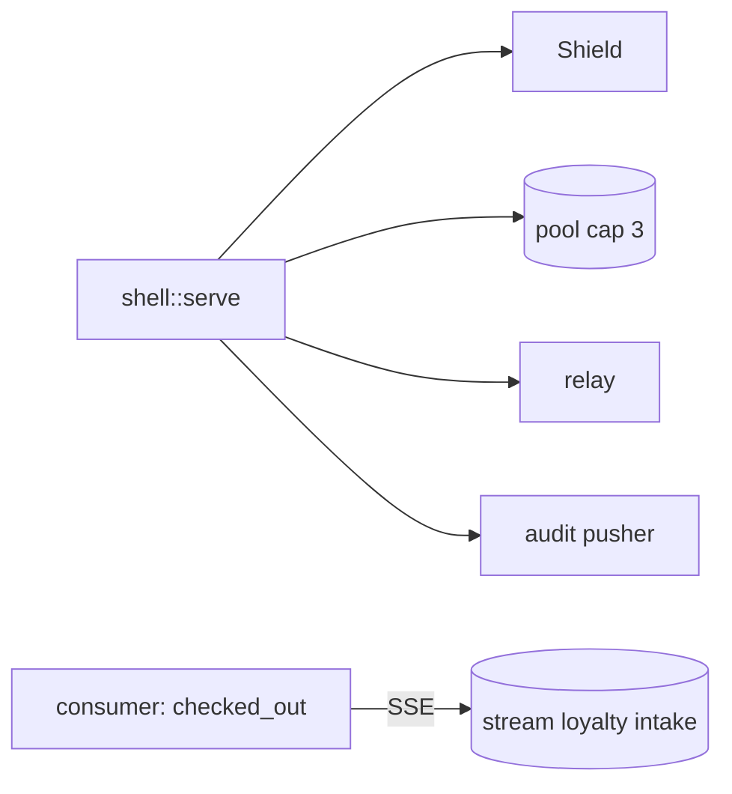
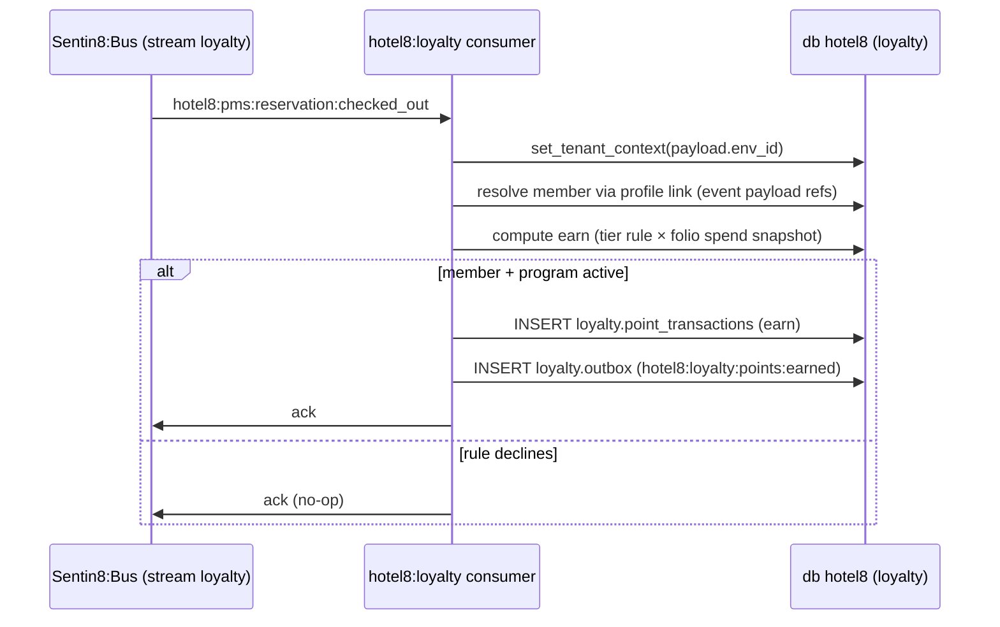
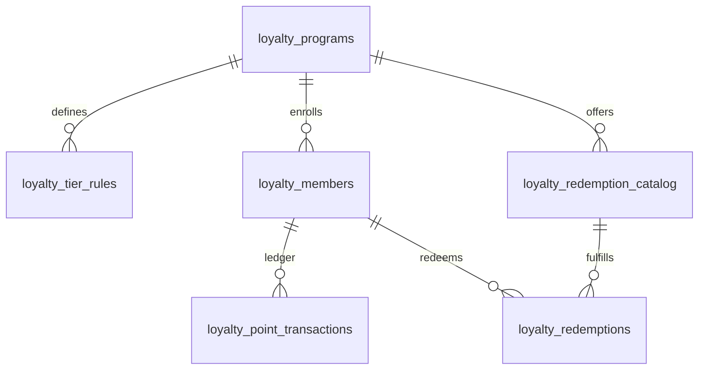
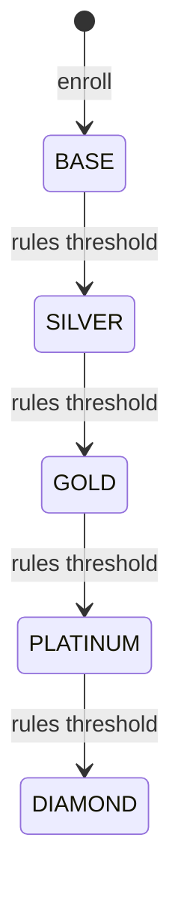
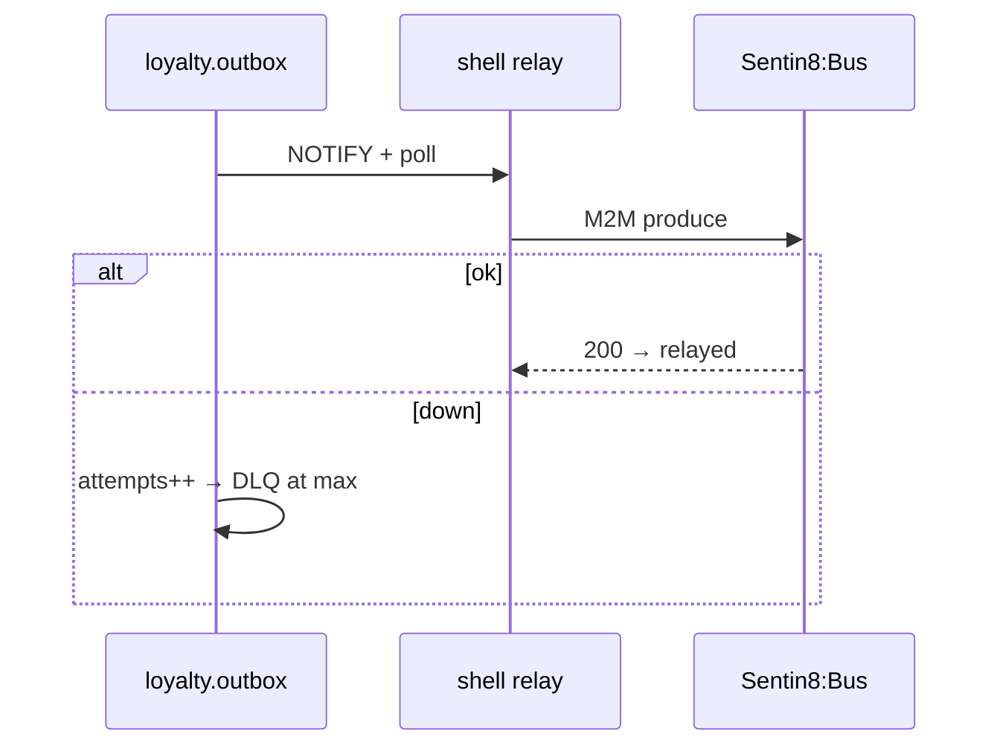
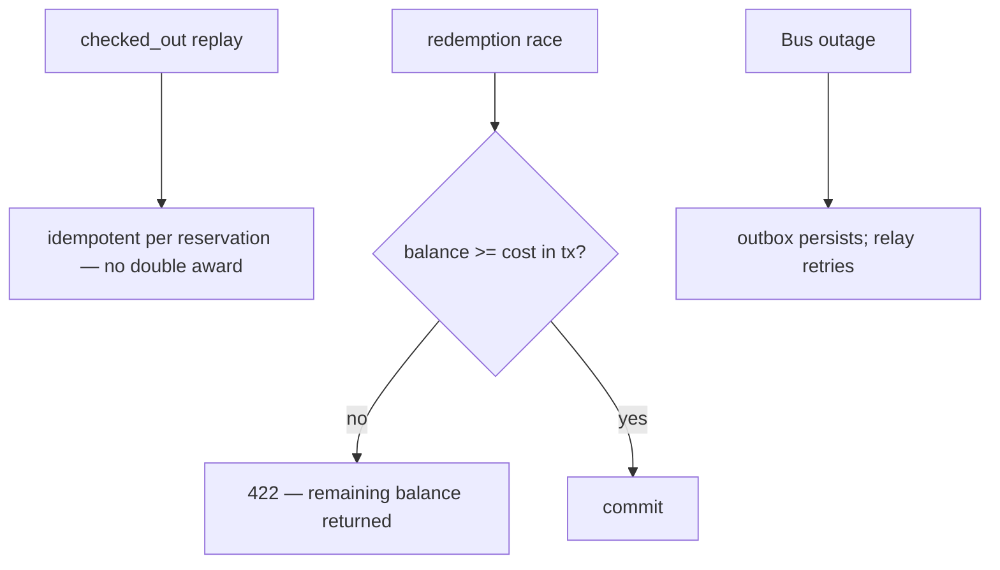
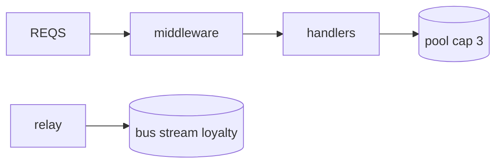
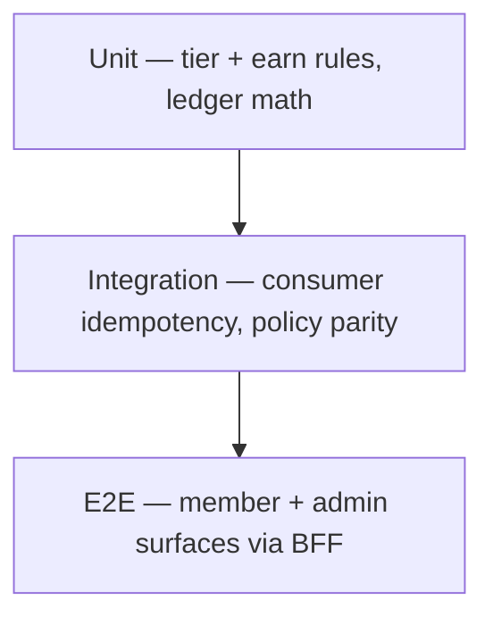

# DESIGN.md: Hotel8:Loyalty — Detailed Design Document

## 1. Scope & Context

**Owned by Loyalty:** database `hotel8`, schema `loyalty` — 8 tables
(`loyalty.programs`, `members`, `point_transactions`, `tier_rules`,
`redemption_catalog`, `redemptions` + `loyalty.tier` / `loyalty.txn_type`
enums + `loyalty.outbox` / `loyalty.audit_journal`); event family `loyalty`;
the stay-points direct consumer; RFW admin pages.

**NOT owned:** guest identity (Sentin8:Auth), guest profiles/stays
(hotel8:pms; the member-link is PMS's field), reward usage at tables
(hotel8:pos calls redemption), notification delivery (Sentin8:Post).

### System context



### Container view



## 2. Runtime Architecture



### Request lifecycle — stay points (event path)



### Request lifecycle — redemption (API path)

```mermaid
sequenceDiagram
    participant C as Client (BFF)
    participant L as hotel8:loyalty
    participant S as Shield
    participant DB as db hotel8
    C->>L: POST /v1/redemptions {member, reward}
    L->>S: require(hotel8:loyalty:points:write)
    S-->>L: permit
    L->>DB: BEGIN; balance check; INSERT redemption + txn (redeem); outbox; journal; COMMIT
    alt insufficient balance
        L-->>C: 422 with remaining balance
    end
    L-->>C: 200 redemption
```

## 3. Data Model



- `tier`: BASE/SILVER/GOLD/PLATINUM/DIAMOND enum · `txn_type`:
  EARN/REDEEM/ADJUST/EXPIRE/TRANSFER enum.
- All tables env-scoped + FORCE-RLS; audit journal included.

### Tier progression



## 4. API Surface

**Public** (member realm via BFF; `hotel8:loyalty:{read}`): member profile +
balance, transaction history, catalog browse.

**Member mutations** (`hotel8:loyalty:points:write`): redeem reward,
transfer (where program permits).

**Admin** (`hotel8:loyalty:admin` + `hotel8:loyalty:points:write`): programs
CRUD, tier rules, points adjust, member link (`member:linked`),
redemption catalog CRUD, EOD-tier review (`tiers:reviewed`).

### Cross-service data access — decision order (membus → bus → owner API)

Awards accrual is event-first: `hotel8:pms:reservation:checked_out`
(consumer group `loyalty-awards`) triggers earning — the bus path. The
residual synchronous path is the PMS owner API for profile
write-back when a member links (`set_loyalty_number`) — a read-your-writes
mutation that must return the updated profile to the caller in the same
request. MemBus: none (member balances change at transaction pace, not tick
pace; newest-wins adds nothing). No pms-schema grant — loyalty reads PMS
only through its API, and never the reverse (PMS holds no loyalty grants).

### Event flow



## 5. Cross-Cutting Concerns

Auth/tenant/RLS/audit/drain/TLS pool — the platform contract, shell-owned;
tier-aware ABAC (points:adjust authority) is tenant-authored.

## 6. Failure Modes & Recovery



## 7. Concurrency & Performance Model



- Balance check is in-transaction (SELECT then conditional INSERT of the
  redeem txn) — no SELECT-then-act race.
- Event payload carries the spend snapshot — no PMS read-back on the hot
  path.

## 8. Invariants, Insecure-Defaults Rejected, Unsafe Rationale

- Balance = Σ ledger by movement type; adjustments self-document their
  actor.
- A redemption never sends the balance negative.
- Award idempotency per reservation (replay-safe).
- No `unsafe`; no platform-DB access; no secrets.
- Insecure defaults rejected: no direct PMS folio reads (spend arrives in
  event payload); no self-service tier promotion.

## 9. Testing Strategy



## 10. Open Questions

- Airline/partner transfer support.
- Benefit catalogs beyond points (gift/match tiers).

---

**Design attribution:** hotel8:loyalty and its underlying concepts were designed by Hamid Jahanzad <Hamid@Jahanzad.com>.

