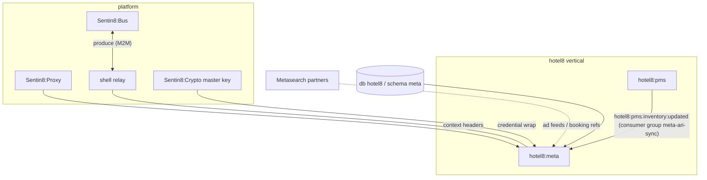
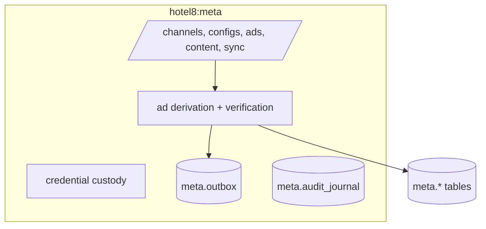
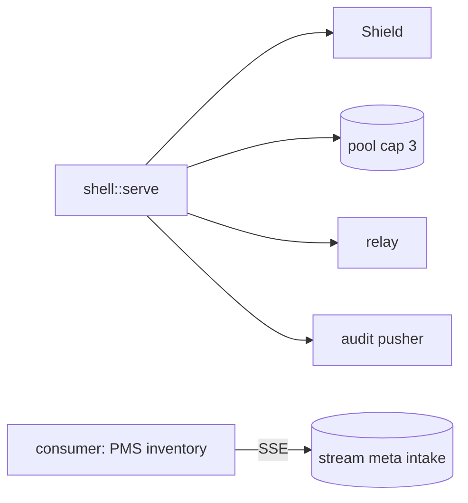
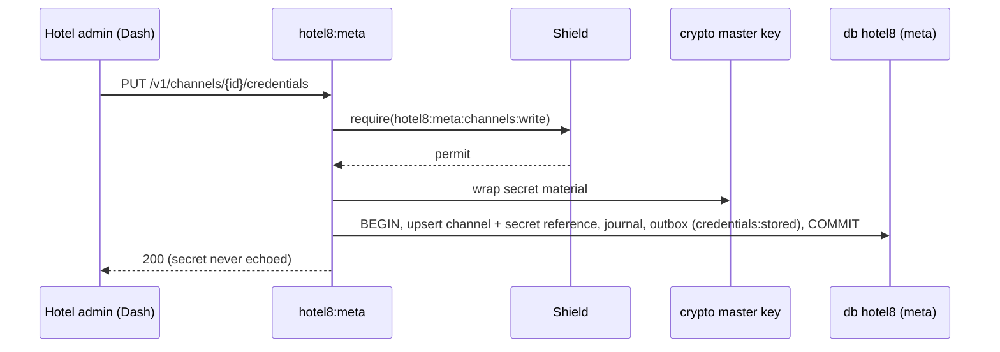
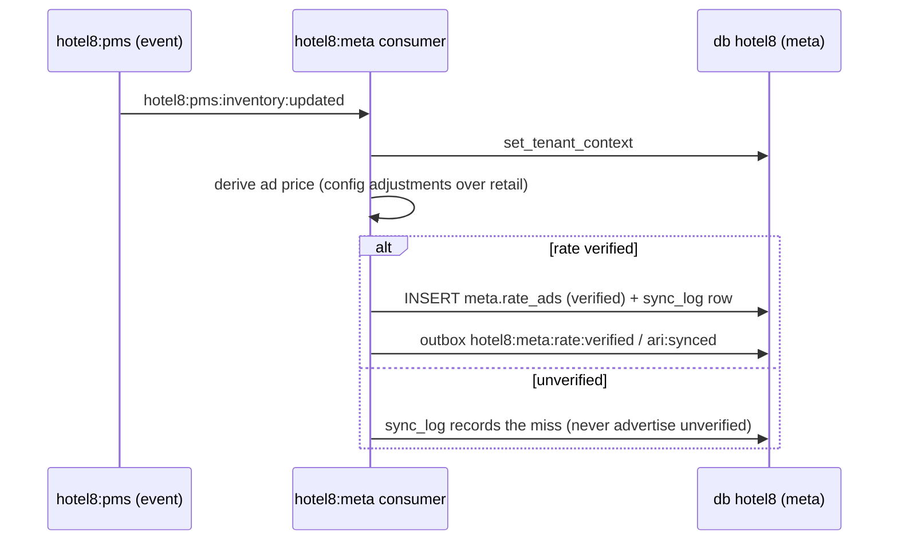
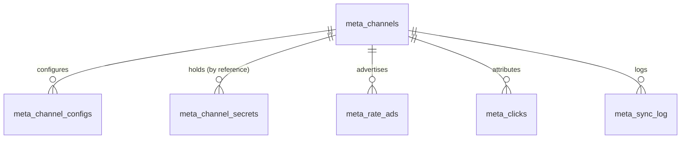
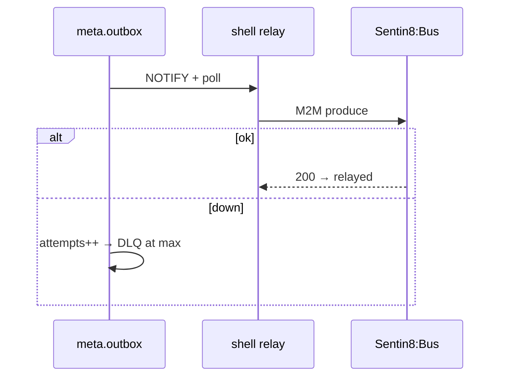
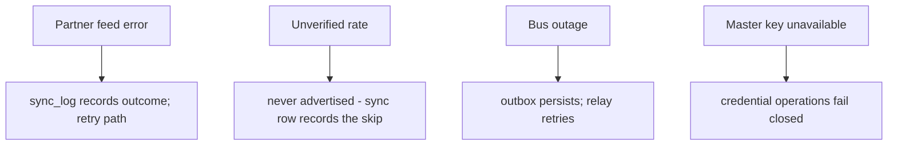
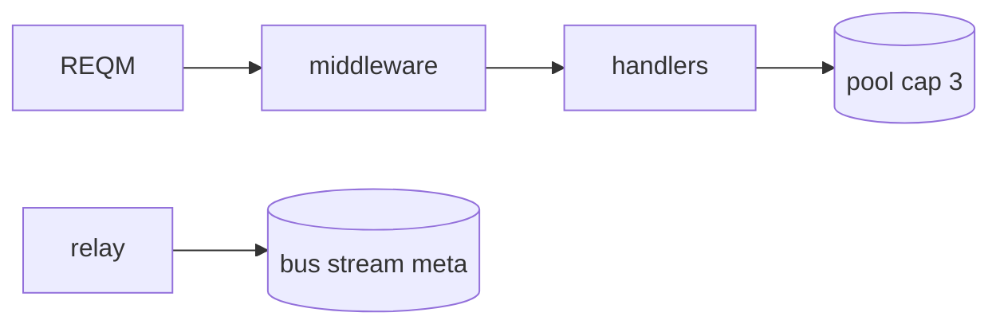
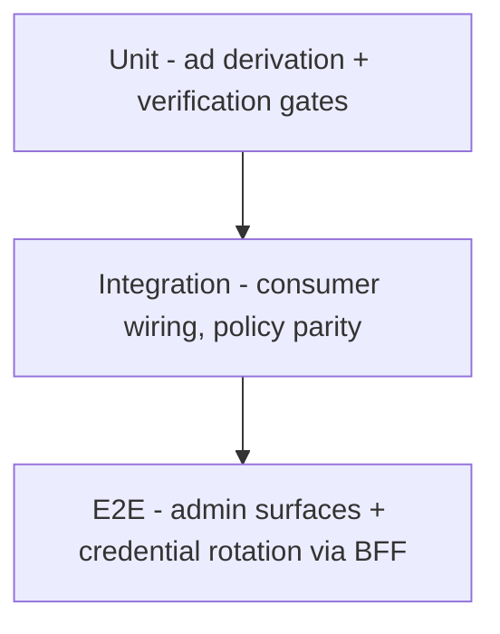

# Hotel8:Meta - Detailed Design Document

## 1. Scope & Context

**Owned by Meta:** database `hotel8`, schema `meta` - 8 tables
(`meta.channels`, `channel_configs`, `channel_secrets`, `rate_ads`, `clicks`,
`sync_log` + `meta.channel_type` enum + `meta.outbox` /
`meta.audit_journal`); event family `meta`; the ARI-republish direct
consumer; RFW admin pages.

**NOT owned:** rate/inventory truth (hotel8:pms), distribution mechanics
(hotel8:distrib), auth decisions (Sentin8:Auth + Shield), payment capture.

### System context

### Container view

## 2. Runtime Architecture

### Request lifecycle - save channel credentials

### Request lifecycle - rate ad verification

## 3. Data Model

- `channel_type`: GOOGLE/TRIVAGO/KAYAK/SKYSCANNER/TRIPADVISOR/BING (enum).
- `channel_secrets`: secret-reference storage (wrapped by the platform
  master key), env-scoped FORCE-RLS.
- All tables env-scoped; audit journal included.

## 4. API Surface

**Public/admin** (`hotel8:meta:{read,write,channels:write}` + scope-mirror):

- Channels CRUD (`channel:configured/updated/deleted`).
- Channel configuration and credential storage
  (`credentials:stored`).
- Rate ads management and verification (`rate:verified`).
- Content push (`content:pushed`); full sync (`full_sync:completed`);
  partial sync (`ari:synced`; `ari:sync` trigger).
- Reservation-write hook for metasearch booking refs
  (`reservation:write`).
- Click/attribution listing; sync-log browsing.

**Admin/RFU**: RFW pages + shared policy admin trio.

### Cross-service data access - decision order (membus → bus → owner API)

Rate-ad freshness rides the bus: `hotel8:pms:inventory:updated` (consumer
group `meta-ari-sync`) re-derives rate ads from live availability - the
event carries the inventory snapshot, so re-derivation needs no PMS
call-back on the hot path. The owner-API residual is the daily ARI horizon
pull (`get_inventory` - synchronous read-your-writes for verification) and
reservation-write hook-backs from metasearch booking refs (the caller
returns the PMS confirmation). MemBus: none - ad refresh cadence is
content-sync pace. No pms-schema grant; meta's partner secrets stay in
meta.channel_secrets.

### Event flow

## 5. Cross-Cutting Concerns

Auth/tenant/RLS/audit/drain/TLS/pool - platform contract via the shell.
Secret handling follows sentin8-secret-handling: references in tables,
plaintext only in-process via the master key.

## 6. Failure Modes & Recovery

## 7. Concurrency & Performance Model

- Read-mostly; the consumer republish is batched per channel from one PMS
  event.
- Clicks write append-only telemetry (no read-modify-write).

## 8. Invariants, Insecure-Defaults Rejected, Unsafe Rationale

- A published ad always carries a verified rate reference.
- Channel secrets are never stored plaintext, never logged, never returned
  by any read endpoint.
- Credential operations are fail-closed on key unavailability.
- No `unsafe`; no platform-DB access.
- Insecure defaults rejected: no shared tenant-wide credential; per-channel
  envelopes only.

## 9. Testing Strategy

## 10. Open Questions

- Bid-strategy automation.
- Programmatic content generation.

---

**Design attribution:** hotel8:meta and its underlying concepts were designed by Hamid Jahanzad <Hamid@Jahanzad.com>.

