# DESIGN.md: Hotel8:PMS - Detailed Design Document

## 1. Scope & Context

**Owned by PMS:**

- Database `hotel8`, schema `pms` - 35 tables (properties, room types, rooms,
  rate plans, rate schedules, inventory, packages, guest profiles,
  reservations, folios, folio charges, folio payments, blocks, events, LOV,
  housekeeping tasks, function spaces, event resources, transaction codes,
  gift vouchers, async jobs, reservation messages, service requests, guest
  preferences, EOD log, reservation comments, items, LOV defaults, digital
  keys, feedback, kiosk config, company payment methods, company users,
  + producer tables `pms.outbox` / `pms.audit_journal`).
- Event family `pms` (stream family derived from the service role) - the
  reservation/inventory/housekeeping domain events consumed by POS, upsell,
  distrib, meta, loyalty.
- RFW admin surface `/v1/admin/ui/*` + `/v1/admin/*` (13 pages incl. the
  Shield policy admin triplet).

**Explicitly NOT owned (delegated):**

| Concern | Owner |
|---|---|
| Payment acceptance (charges, refunds, disputes, tokens) | Bill8:Payments |
| Double-entry movements (room-charge settlement) | Bill8:Ledger (balance-transactions) |
| Folio-settlement account provisioning | Bill8:Ledger - lazy-ensured from PMS (`ensure_settlement_balances`), idempotent per env |
| Object storage (property images) | Sentin8:Storage |
| Transactional email delivery | Sentin8:Post |
| Identity, JWKS, authorization decision | Sentin8:Auth + Shield |
| WASM functions, schedules, workflows | Sentin8:Func / Cron / Flow |

### System context

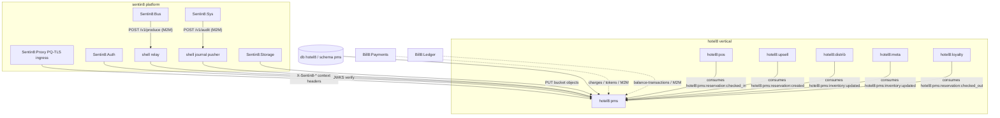

### Container view

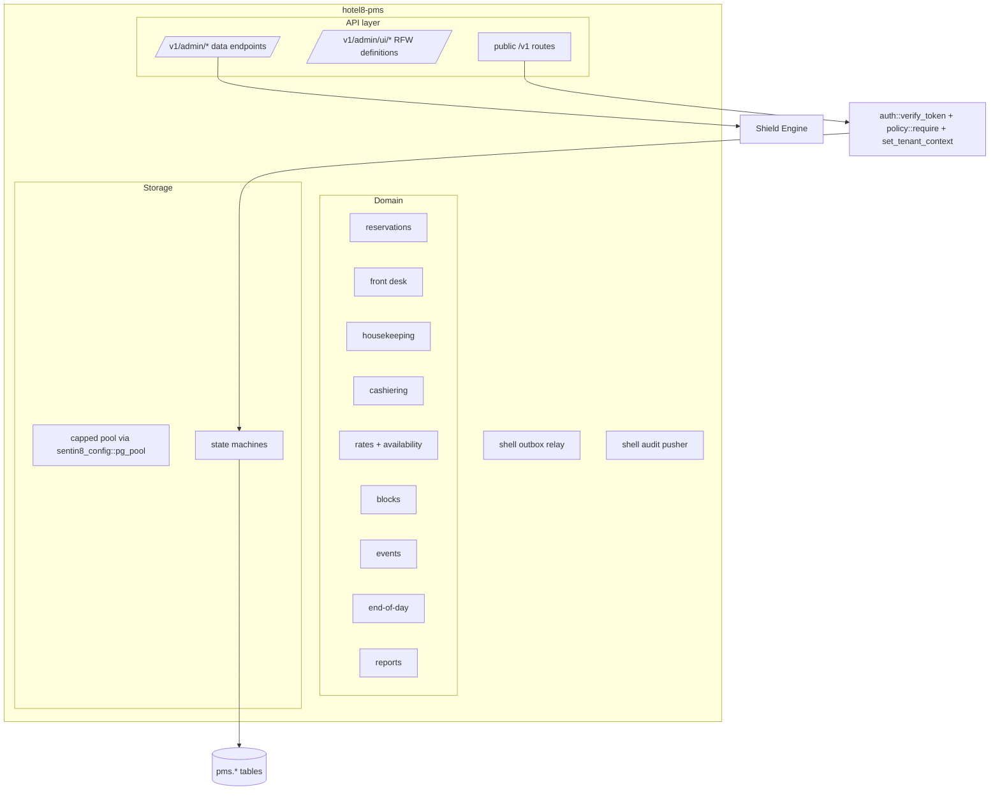

## 2. Runtime Architecture

The binary boots on `sentin8::shell::serve` (design:
`sentin8/design/sentin8-sentin8-shell-technical-design.md`): registration
flag, PQ crypto provider, config, capped pool (`pg_pool::connect`), PG18
check, state binding, OpenAPI merge, middleware stack, PQ-TLS listener,
Shield engine boot-load + hot-reload, outbox relay, audit-journal pusher are
shell-owned. The binary wires registration data, `server::build_state`, and
routes only.

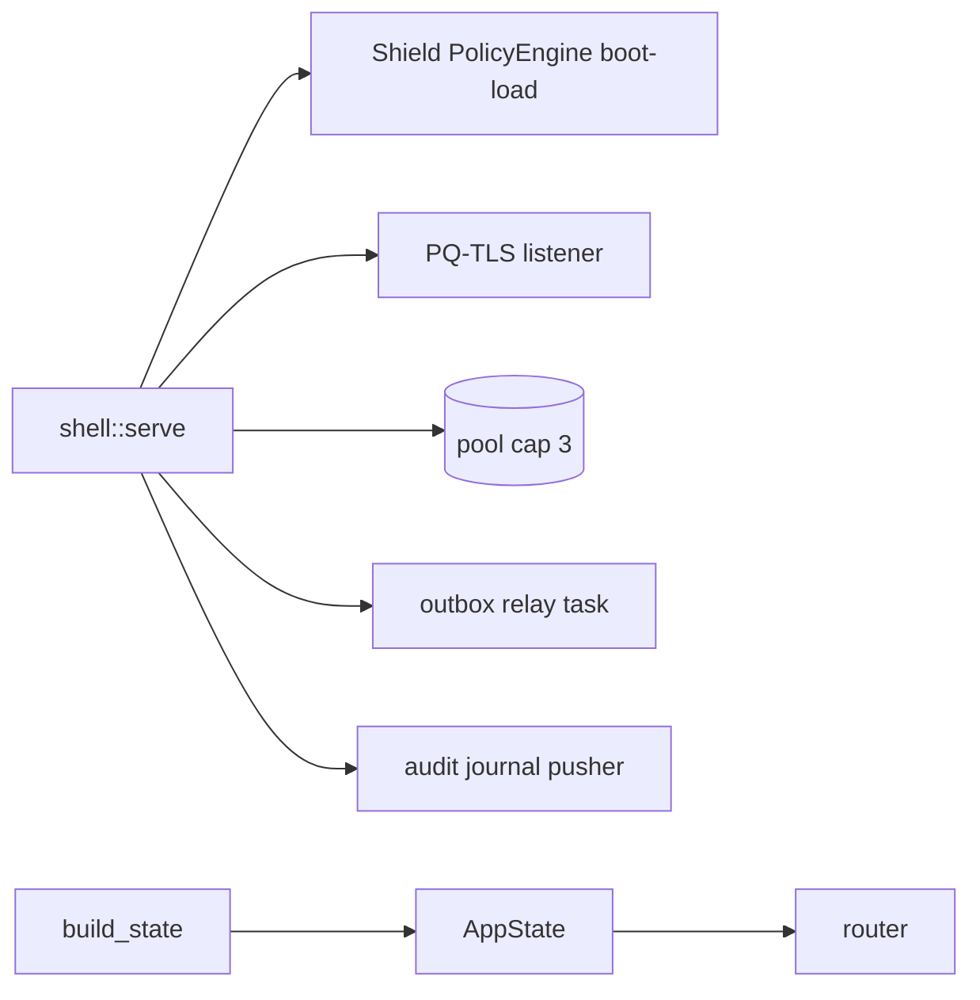

### Request lifecycle - public domain read

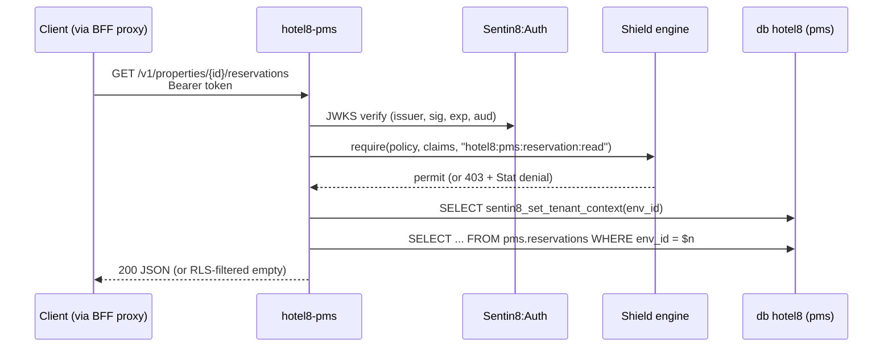

### Request lifecycle - mutation with event + audit

```mermaid
sequenceDiagram
    participant C as Client
    participant P as hotel8-pms
    participant S as Shield
    participant DB as db hotel8
    participant BUS as Sentin8:Bus
    C->>P: POST /v1/properties/{id}/reservations
    P->>S: require(hotel8:pms:reservation:write)
    S-->>P: permit
    P->>DB: BEGIN
    P->>DB: set_tenant_context
    P->>DB: INSERT pms.reservations
    P->>SM: ReservationState transition guard
    P->>DB: INSERT pms.outbox (hotel8:pms:reservation:created)
    P->>DB: INSERT pms.audit_journal
    P->>DB: COMMIT
    P-->>C: 201 reservation
    Note over DB,BUS: post-commit - shell relay drains pms.outbox
    BUS->>BUS: produce (idempotency_key = outbox row id)
    alt relay failure (Bus down)
        DB->>DB: row stays unrelayed; 5s safety poll retries
    end
```

## 3. Data Model

All tables in `pms.*`, every tenant table FORCE-RLS'd to the standard
env-scoped predicate. Producer tables are env-scoped too (the relay rides the
service pool under the service role).

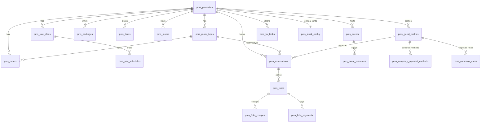

- All tables env-scoped (`env_id UUID NOT NULL`), RLS tier `env`; holder-scoped
  rows (company payment methods, company users) additionally guard on the
  owning company profile id.
- Secrets are never stored in PMS: guest tokens live with Sentin8:Auth;
  channel secrets with hotel8:meta; payment methods store bill8 token
  references only (`payment_method_id`), never PAN or token secrets.
- Lifecycle columns use PostgreSQL enums in `pms.*_status` types; the Rust
  state machines assert the legal transitions before SQL.

### Guest-app surfaces (self-service)

The guest-facing apps (eGuest, eKiosk) consume PMS through the BFF using
narrow, self-service shapes - the same tables above, exposed with
guest-filterable routes and one new table per physical key model:

| Surface | Route | Notes |
|---|---|---|
| Guest reservation lookup | `GET /v1/properties/{property_id}/reservations?guest_profile_id=&upcoming=&last_name=&confirmation=` | filters on the existing list; `upcoming=true` restricts to `arrival_date >= today` and non-terminal statuses |
| Key issuance | `POST /v1/properties/{property_id}/digital-keys` | rows in `pms.digital_keys` (reservation-scoped), status `INACTIVE` |
| Key lifecycle | `POST .../digital-keys/{id}/activate` / `.../deactivate`, `GET .../digital-keys?reservation_id=` | state machine: `INACTIVE → ACTIVE → {REVOKED, EXPIRED}` |
| Folio by room | `GET /v1/properties/{property_id}/folios?room_number=` | the check-out wizard's settlement view (opens folio of the in-house stay in that room) |
| Boarding pass / key slip | `GET /v1/properties/{property_id}/reservations/{id}/boarding-pass` | computed view: room, dates, guest, key count - rendered by the kiosk completion step |
| Stay feedback | `POST /v1/properties/{property_id}/feedback`, `GET .../feedback?reservation_id=` | one rating per reservation; rows in `pms.feedback` |

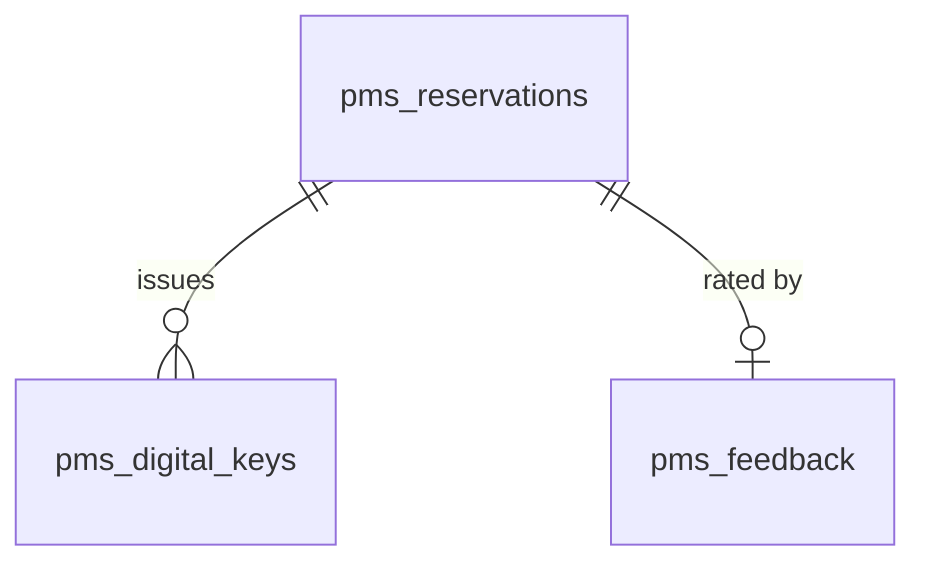

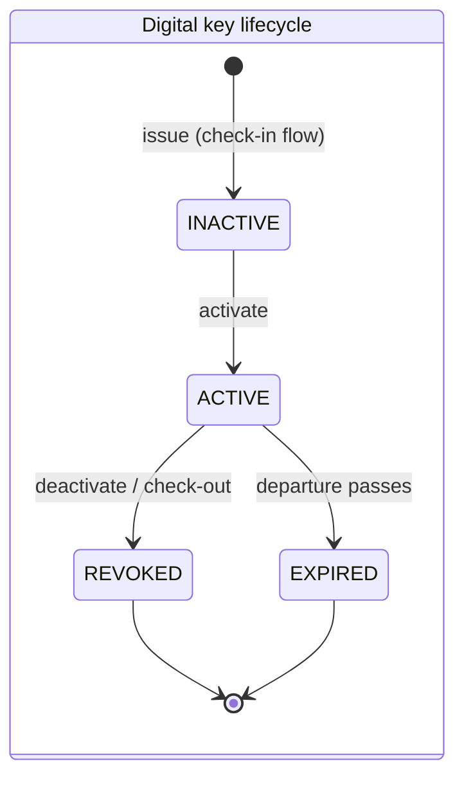

Invariants: keys exist only for `CHECKED_IN` reservations; a key is
deactivated automatically at check-out (the check-out handler revokes active
keys for the reservation); `pms.feedback` accepts one row per
`(reservation_id)` - re-submission updates the rating, never duplicates.

### Staff & corporate surfaces

| Surface | Route | Notes |
|---|---|---|
| Reservation edit | `PUT /v1/properties/{property_id}/reservations/{id}` | ePMS edit flow: dates, occupancy, room type/rate plan; refused with 409 for `CANCELLED`/`CHECKED_OUT`/`NO_SHOW` |
| Walk-in booking | `POST /v1/properties/{property_id}/walk-in` | kiosk express-booking: creates a `CONFIRMED` reservation (source `WALKIN`, channel `KIOSK`) from an available room type + guest name; the kiosk then check-ins via the normal route |
| Corporate credit methods | `GET/POST/DELETE /v1/properties/{property_id}/companies/{profile_id}/payment-methods` | rows in `pms.company_payment_methods` - bill8 token references only; `approval` ∈ {`PENDING`, `POSTPAY`, `BILL_TO_COMPANY`, `REJECTED`}; eCorpCheckout surfaces the `POSTPAY`/`BILL_TO_COMPANY` set |
| Company user binding | `GET/POST /v1/properties/{property_id}/companies/{profile_id}/users` | rows in `pms.company_users`; one traveler may belong to many companies - the session binds ONE active company per call (no org-wide bypass) |
| Kiosk terminal config | `GET/PUT /v1/properties/{property_id}/kiosk-config` | one row per property (unique) - enabled modes (`CHECK_IN`,`CHECK_OUT`,`COLLECT_KEY`,`WALK_IN`), add-on package codes, lockdown flag, max key count; eKiosk reads it at bootstrap and gates its mode menu; admin RFW page edits it |
| Corporate admin provisioning | `GET/PUT /v1/properties/{property_id}/companies/{profile_id}/admin-provisioning` | SSO-free first-admin onboarding: `requires_provisioning` = no IdP (`preferences.sso_provider`) AND no bound ADMIN; `PUT` idempotently binds the resolved-or-created traveler as `ADMIN` and stamps `preferences.provisioned_admin_at` (event `hotel8:pms:company:admin_provisioned`) |
| Corporate availability (rate-mix) | `POST /v1/properties/{property_id}/corporate-availability` | rate-mix policy: with a `company_profile_id` in the request, ONLY negotiated plans linked to that company (`preferences.negotiated_rate_plan_ids`) are returned - public plans are withheld (never leak, never fallback); same availability math as the public search |

### Domain state machines

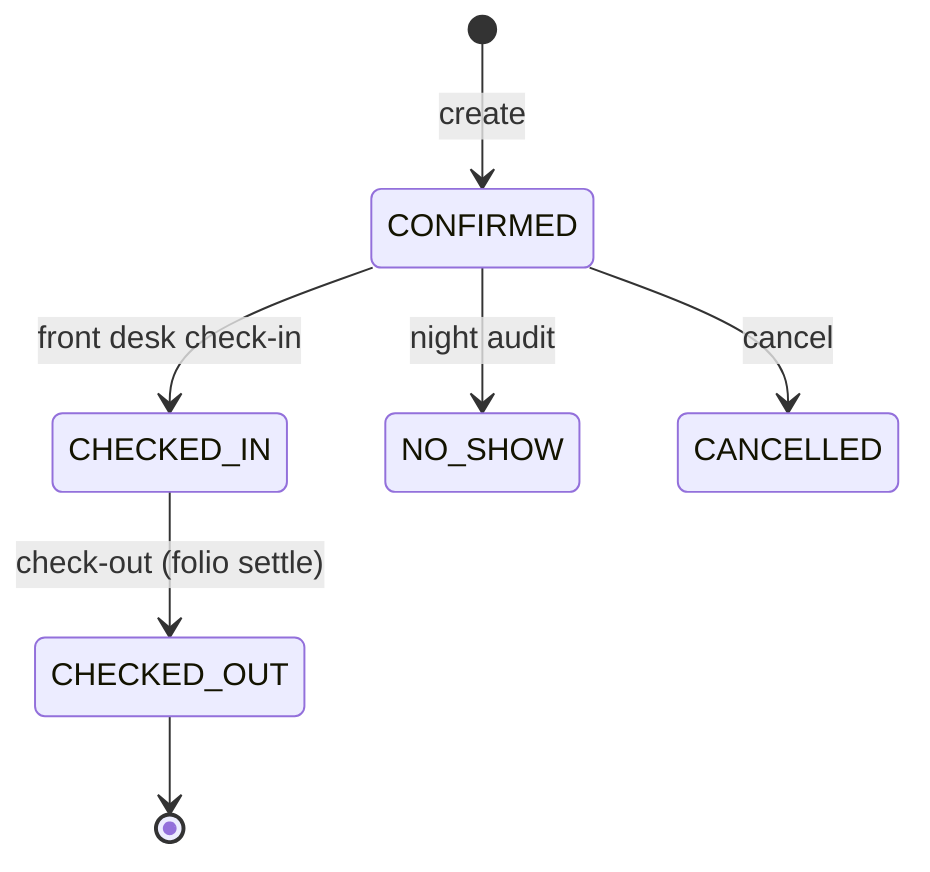

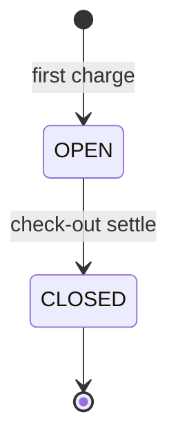

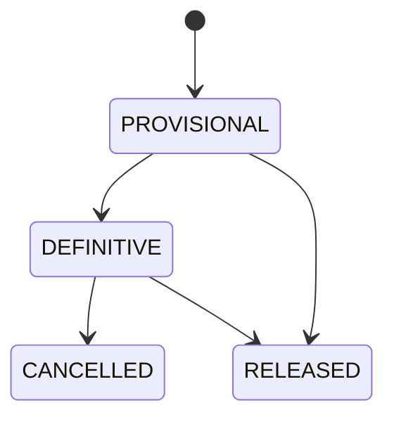

## 4. API Surface

**Public** (bearer + Shield gate, all emit domain events through
`pms.outbox`):

- Properties/rooms/types/rate-plans/items CRUD -
  `hotel8:pms:{resource}:{read|write}` scope mirror set.
- Availability search (`/v1/properties/{id}/availability`, org-wide
  `/v1/availability`).
- Reservations CRUD (incl. `PUT` edit + `POST` cancel) + split; front-desk
  check-in/check-out/revert + in-house list.
- Walk-in booking (`POST .../walk-in`) + kiosk terminal config
  (`GET/PUT .../kiosk-config`).
- Corporate surfaces: company payment methods (credit approval) + company
  user bindings under `/v1/properties/{id}/companies/{profile_id}/...`.
- Housekeeping tasks (`PUT .../{room_number}` - `hk_status` transitions).
- Cashiering: folio get, charge post, payment post, folio generation.
- Blocks CRUD + status transitions (`block_status`).
- Events (banquet) CRUD + resource assignment.
- Reports; LOV lookup; settings (module config, external systems).
- Storage-backed property image upload; async job input + result.
- Integration: payments, ledger postings, Post email, Func module execution.
- Guest-app surfaces (see §3 "Guest-app surfaces"): reservation filters
  (`guest_profile_id`/`upcoming`/`last_name`+`confirmation`), digital keys
  (issue/activate/deactivate/list under
  `/v1/properties/{id}/digital-keys`), folios-by-room
  (`GET .../folios?room_number=`), boarding pass, stay feedback.
- **Authorization mapping (kiosk/guest payments):** bill8 exposes
  authorization as a `payment-intent` with manual confirm - the kiosk
  "pre-authorization" is `POST /v1/payment-intents` +
  `POST /v1/payment-intents/{id}/confirm` on bill8:payments (scopes
  `bill8:payments:intents:write`), and capture is `POST /v1/charges`
  (`bill8:payments:charges:write`). There is no separate
  `/v1/authorizations` endpoint.

**Admin/RFU**: `/v1/admin/ui/{page}` (14 RFW pages - domain pages + settings
+ kiosk-config + the corporate-accounts page), `/v1/admin/{resource}`
data endpoints for the domain pages (reservations, frontdesk, housekeeping,
rates, blocks, events, profiles, reports, settings, companies,
company_users, negotiated_rates - RLS-filtered JSON the tables render) +
form-submit aliases (`POST/PUT/DELETE /v1/admin/{resource}/...` reusing the
domain handlers - incl. `company_payment_methods`/`company_users`/`rate_links`
for the corporate page),
incl. the shared Shield policy-admin trio
(`/v1/admin/policy-sets|relations|attributes`). Page definitions gate on
`hotel8:pms:admin`; data reads gate on the resource's `read` scope; submit
aliases gate on the resource's `write` scope (Shield step 5 - the scope-mirror
set carries every action).

**Health**: `/v1/health` custom payload (drain gauge shared with the request
counter).

### Cross-service data access - decision order (membus → bus → owner API)

PMS is the vertical's primary *producer*: reactions to reservations,
inventory, folios, and kiosk config are consumed by POS/upsell/loyalty/
distrib/meta directly off the `pms` stream (their consumer groups), so PMS
gains no internal fan-out API. Outbound reads PMS itself makes follow the
platform decision order (architecture principles §4.7):

1. **MemBus state refresh** - none today: nothing PMS consumes repeats fast
   enough to need newest-wins ephemeral state.
2. **Sentin8:Bus events** - PMS consumes platform env-init events (e.g.
   `sentin8:sys:service:updated` family reactions land in its consumer
   plumbing) rather than polling owner APIs.
3. **Owner HTTP API** - the residual path for synchronous read-your-writes
   only (e.g. the integration lane's payments/ledger/post calls). PMS never
   reads another service's schema - no cross-schema GRANT, no FDW/dblink
   (§6.6a).

### Event flow - outbox → Bus → trigger

```mermaid
sequenceDiagram
    participant DB as pms.outbox
    participant REL as shell relay
    participant BUS as Sentin8:Bus
    participant CON as direct consumers
    DB->>REL: NOTIFY pms_outbox_changed
    REL->>BUS: M2M / POST /v1/produce (sentin8:bus:produce)
    alt accept
        BUS-->>REL: 200
        DB->>DB: row relayed = true
    else failure
        DB->>DB: relay_attempts += 1; 5s poll retries; DLQ at max
    end
    BUS->>CON: stream pms (XADD bus:{env}:pms)
    CON->>BUS: ack (consumer groups)
```

## 5. Cross-Cutting Concerns

- **Authentication** - every handler calls `auth::verify_token` (shell-provided
  JWKS verification); M2M tokens accepted alongside user tokens; no bearer →
  401 before any domain logic.
- **Tenant resolution + RLS** - ingress `X-Sentin8-*` headers are the only
  tenant source; `set_tenant_context` runs on the pooled connection inside the
  transaction; explicit `env_id = $n` clauses are defense-in-depth alongside
  the RLS policies.
- **Idempotency & exactly-once** - outbox `relayed` state + Bus dedupe on row
  id; consumers dedupe by `idempotency_key`; posting batches carry a unique
  idempotency key column.
- **Rate limiting** - enforced at the BFF/ingress layer, not in PMS; PMS
  exposes its intended limits on the health endpoint for operational parity.
- **Audit journaling** - same-transaction `pms.audit_journal` rows for all
  mutating handlers; shell pusher ships to Sys with fail-open retry.
- **Graceful drain** - health endpoint shares the request counter's in-flight
  gauge; upgrade-instance polls `/v1/health` until in-flight drains before
  stopping the old process.
- **TLS posture** - PQ-X25519MLKEM768 listener via `sentin8-tls`; no
  `danger_accept_invalid_certs`; service never touches hostname resolution
  (embedded DB-free HostContextResolver).

## 6. Failure Modes & Recovery

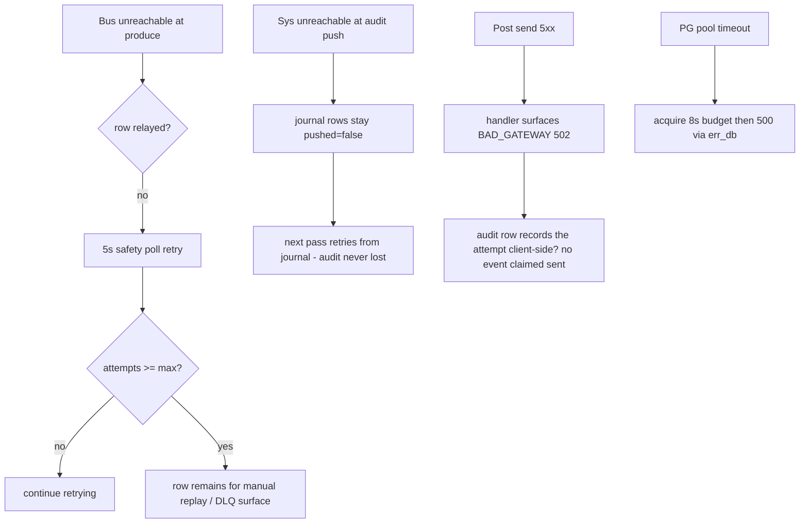

- Relay and journal-pusher are **fail-open**: an outage only disables the
  background task, traffic continues serving.
- Mid-transaction crash is recovered by PostgreSQL atomicity - partial
  writes never commit (outbox row and domain row share the commit).
- A workload-certificate mint failure at startup keeps the bus client
  retrying in its boot loop (2s cadence) - never crash-looping the service.

## 7. Concurrency & Performance Model

- Single tokio multi-thread runtime; axum worker fan-out; no dedicated
  background tasks other than the shell-owned relay/pusher/policy reload.
- Pool: `pg_pool::connect` cap 3 (`SENTIN8_PG_POOL_MAX` override), 8s acquire
  budget - sized for the shared-cluster `max_connections` budget.
- Hot paths: availability search and reservation create - availability is a
  pure filter over `pms_rooms.status` and `pms_inventory`; no N+1: joins in
  SQL, not per-row client aggregation.
- Locking: row-level locks from single DML; the state machines run pre-SQL so
  no advisory locks are needed; EOD runs as one transaction serializing the
  close naturally by its single-row-per-property log.

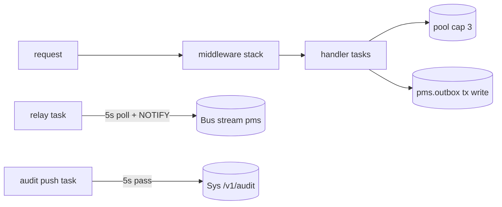

## 8. Invariants, Insecure-Defaults Rejected, Unsafe Rationale

- A committed reservation always has its outbox row and, for mutating
  operations, a journal row (same-transaction rule).
- `pms_rooms` never reflects an occupied room without a folio in `OPEN`.
- Availability can never exceed physical inventory minus OOO/OOS; sell-limit
  never permits overselling a room type.
- No BYPASSRLS role exists for the service; policies always match
  `env_id` + initialized context.
- No `unsafe` blocks; no secrets in tables; no vertical access to platform
  schemas.
- Insecure defaults rejected: no plaintext DSN fallback (vertical DSN is
  required); no un-gated endpoints (every route carries policy + tenant
  context).

## 9. Testing Strategy

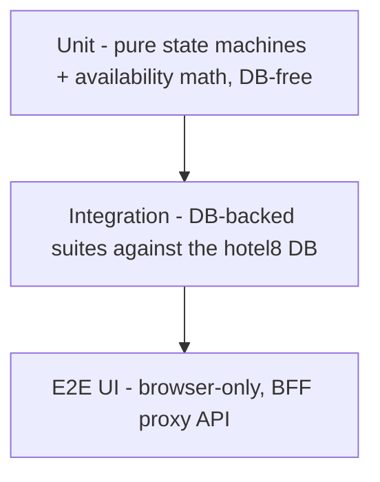

- **Unit**: contracts serde round-trips; `ReservationState`/`FolioState`/
  `BlockState`/`EventState` full transition matrices; availability and
  restriction gating.
- **Integration (DB-backed)**: create-operation handlers (property, room
  type, room, rate plan, rate schedule, profile, reservation, block, event)
  round-trip against the live `hotel8` database - typed date/enum/numeric
  binds verified on the real schema, plus the reservation edit and walk-in
  handlers. Skipped (not failed) when `HOTEL8_PMS_DATABASE_URL` is unset, so
  DB-free CI still runs.
- **E2E (UI-only)**: through Dash/BFF proxy - admin RFW pages, reservation
  lifecycle in the browser. No direct SQL in test setup.
- Deliberately NOT tested here: platform token issuance, Shield engine
  internals, TLS posture - covered by the platform test strategy.

## 10. Open Questions

- Multi-currency folio support (denomination split from property currency).
- Per-room-class overbooking caps beyond the pure sell-limit filter.
- Yield-management pricing beyond the restriction gates.
- Offline order-capture for POS terminals rides the POS offline-sync lane -
  PMS room-charge posting during terminal offline is deferred until that
  platform pattern lands.

---

**Design attribution:** hotel8:pms and its underlying concepts were designed by Hamid Jahanzad <Hamid@Jahanzad.com>.

