# DESIGN.md: Hotel8:POS - Detailed Design Document

## 1. Scope & Context

**Owned by POS:** database `hotel8`, schema `pos` - 14 tables (`pos.checks`,
`pos.orders`, `pos.menu_items`, `pos.menu_categories`, `pos.modifiers`,
`pos.modifier_groups`, `pos.payments`, `pos.tables`, `pos.service_areas`,
`pos.printer_groups`, `pos.revenue_centers`, `pos.tax_groups`, `pos.outlets`,
+ producer tables `pos.outbox` / `pos.audit_journal`); event family `pos`;
RFW admin pages; the check/order lifecycle machines.

**NOT owned:** room inventory and rates (hotel8:pms), folio settlement
(hotel8:pms cashiering) beyond the room-charge hand-off, money movement
(Bill8:Ledger via balance-transactions), card capture (Bill8:Payments),
identity/authorization decisions (Sentin8:Auth + Shield), email
(Sentin8:Post).

### System context

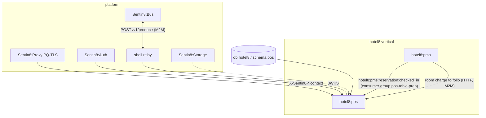

### Container view

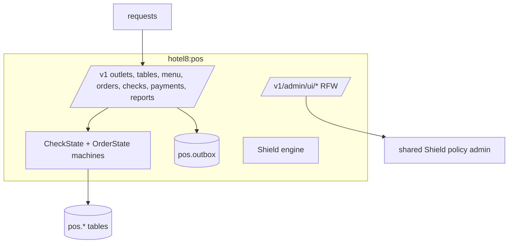

## 2. Runtime Architecture

Shell-owned boot supplies pool, Shield engine, relay, journal pusher and the
PQ listener; the crate contributes registration, state, routes and one direct
consumer task (`event_consumer::spawn`) for the PMS check-in event.

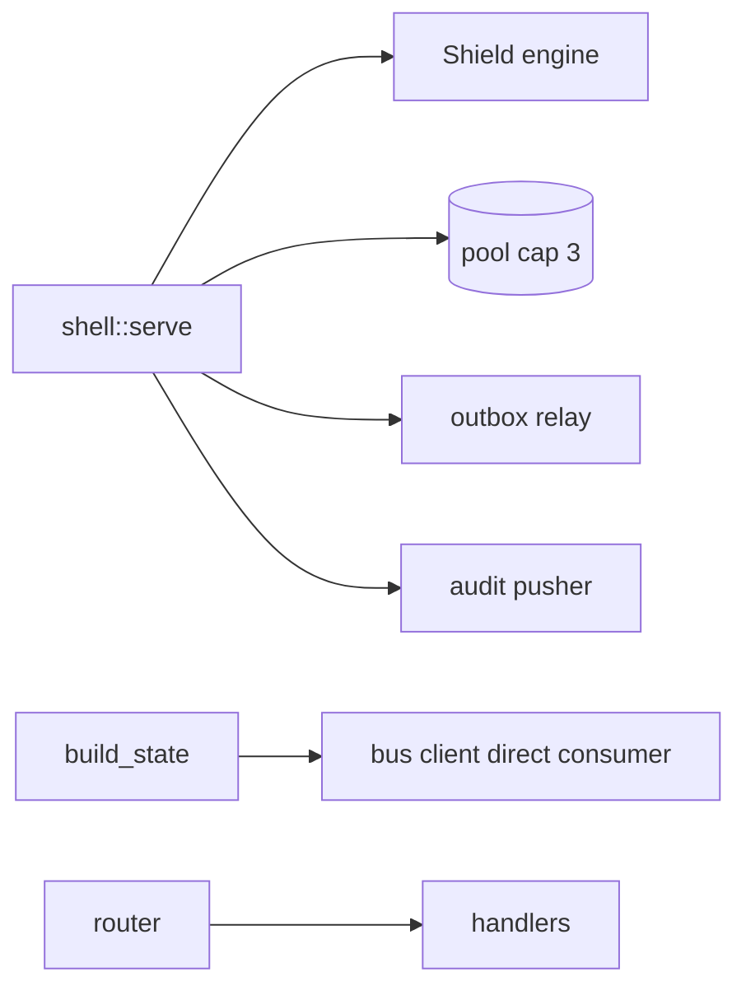

### Request lifecycle - pay a check

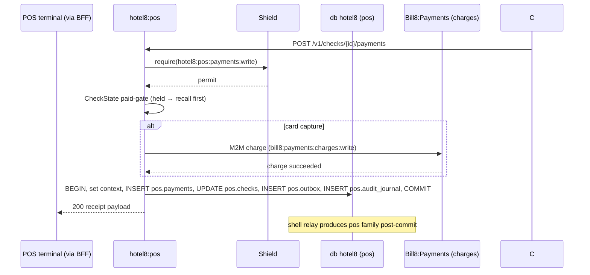

### Request lifecycle - PMS check-in consumed

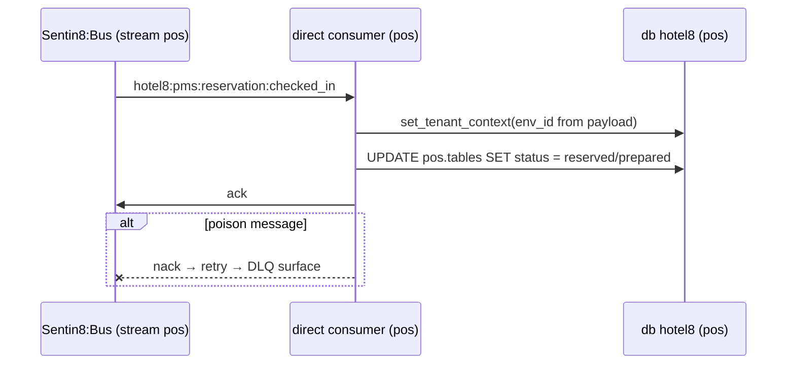

## 3. Data Model

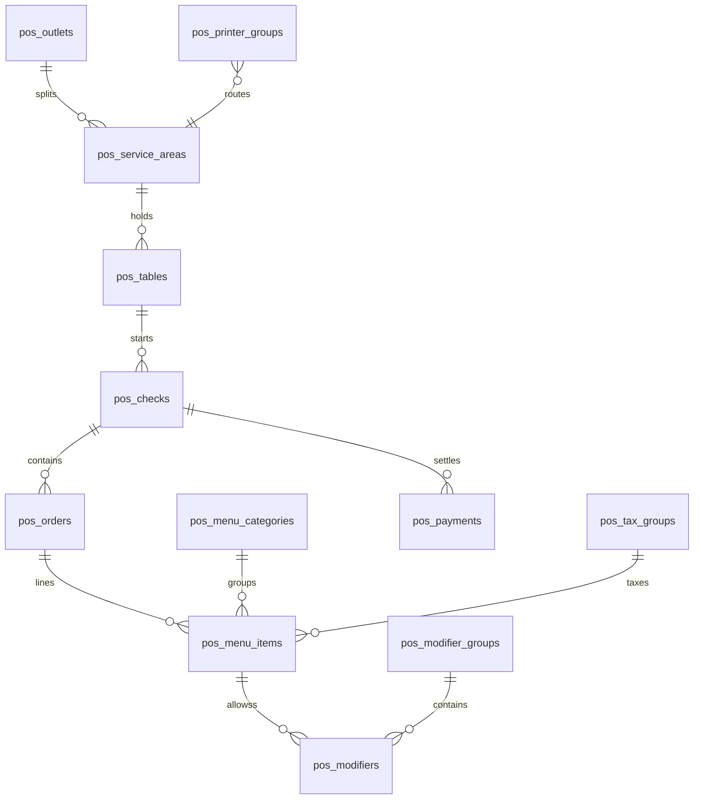

- All tables env-scoped, FORCE-RLS to the standard predicate; audit journal +
  outbox included.
- Money columns carry decimal amounts with the property currency from PMS
  settings; no currency state is invented here.
- Terminal/register identifiers ride Shield ABAC attributes rather than
  columns (tenant-authored).

### State machines

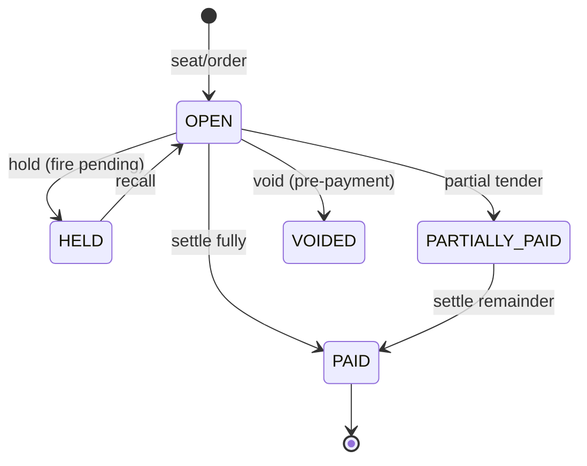

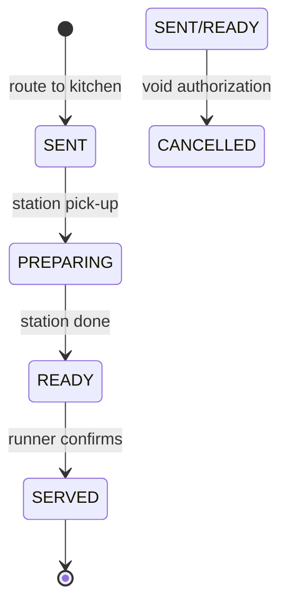

## 4. API Surface

**Public** (Shield-gated, `hotel8:pos:*:{read,write,admin}` scope-mirror):

- Outlets, service areas, tables (combined/separated/status), revenue
  centers.
- Menu categories/items, modifier groups/modifiers, tax groups, printer
  groups.
- Checks: open, hold, recall, split, merge, transfer, void (refund flow
  enforced post-payment).
- Orders: add per seat, void, kitchen routing
  (`hotel8:pos:kitchen:order_routed`).
- Payments: post (incl. room charge to PMS folio), split, request;
  payment-method configuration.
- Discounts; manager approvals for overrides (ABAC-backed).
- Package redemption (redeem hotel8:loyalty rewards at the table).
- Reports incl. `report:eod_generated` + export request; offline terminal
  sync (`hotel8:pos:offline:synced`).
- **Guest ordering (room service)** - guest-scoped routes the eGuest app
  calls through the BFF: `GET /v1/guest/{property_id}/menu` (menu items +
  categories from the outlet flagged `ROOM_SERVICE`), `POST
  /v1/guest/{property_id}/orders` (creates a `ROOM_SERVICE` check bound to
  the in-house reservation + room, opens with the ordered lines), `GET
  /v1/guest/{property_id}/orders/{check_id}` (status read-back). Guest
  ordering reuses the same check/order machines - the only differences are
  the auto-created check attributes (room number + reservation id) and the
  scope gate (`hotel8:pos:guest:write`), which the guest session carries via
  the BFF instead of staff scopes.

**Admin/RFU**: RFW pages + shared policy admin trio (same construction as
PMS).

### Cross-service data access - decision order (membus → bus → owner API)

POS consumes PMS state reactively: `hotel8:pms:reservation:checked_in` on
the `pms` stream (consumer group `pos-table-prep`) opens table-prep for
arrivals - the bus path. Synchronous reads (check-in verification before a
room-charge payment, package redemption eligibility) use the PMS owner API
(`hotel8::pms::client::H8pmsClient` - `get_reservation`,
`search_reservations`) with a POS M2M token: read-your-writes/validation
paths that must block the caller before committing, the narrow internal-API
exception. MemBus: none - terminal state is local, nothing POS consumes
ticks fast enough for newest-wins. There is no pms-schema GRANT - a
cross-service table grant is a defect, not an access path (principles §6.6a).

### Event flow

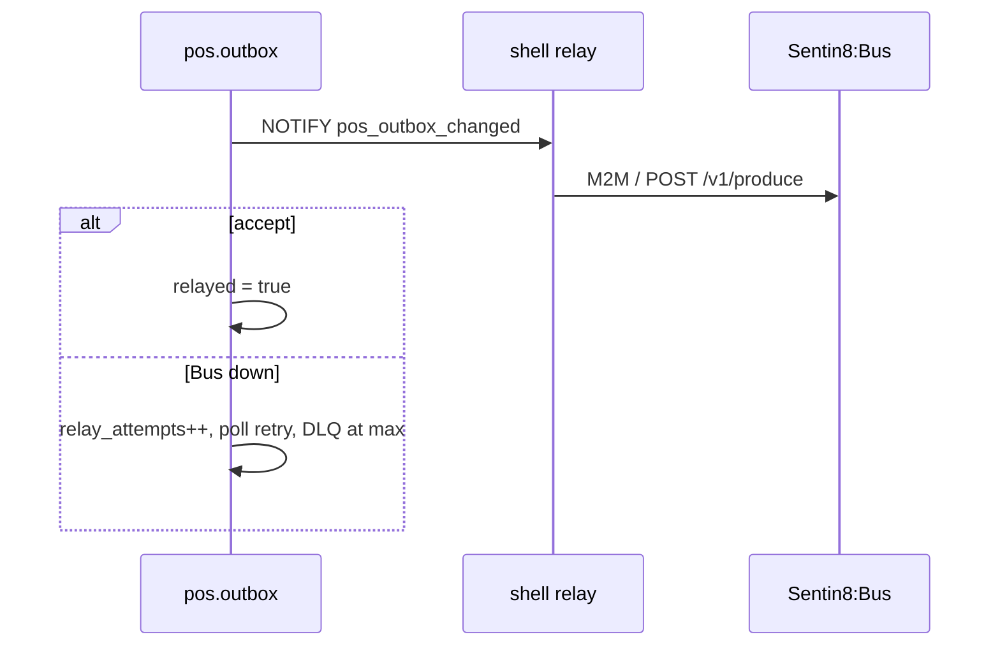

## 5. Cross-Cutting Concerns

- **Authentication** - `auth::verify_token` on every route (user + M2M);
  terminal credentials map to ABAC attributes for location-bound authority.
- **Tenant resolution + RLS** - ingress context headers only; context +
  explicit `env_id` clauses co-applied on the same connection.
- **Idempotency** - payment submission dedupes on client-supplied key; room
  charge idempotency key minted as `hotel8:pos:{transaction_id}` toward
  Bill8:Payments.
- **Audit journaling** - every mutating handler rows `pos.audit_journal`
  in-transaction.
- **Drain/TLS/pool** - identical to the platform contract (shell-owned).

## 6. Failure Modes & Recovery

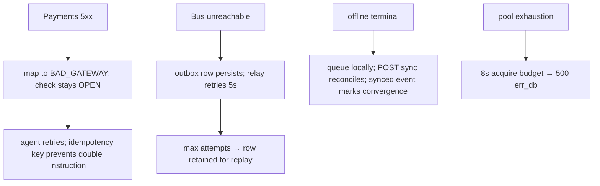

- Void-after-payment is refused with the refund path instead of mutating
  history.
- Relay/journal-pusher fail-open exactly like PMS.

## 7. Concurrency & Performance Model

- Same single-runtime shape as PMS; pool cap 3.
- Check mutation serializes naturally per check (single-row UPDATEs; state
  machine pre-SQL).
- Hot path: order-add during service - single INSERT + outbox row.
- Kitchen display consumes the stream; a slow kitchen state never blocks the
  server path (consumer lag is bounded by the stream, not by POS tasks).

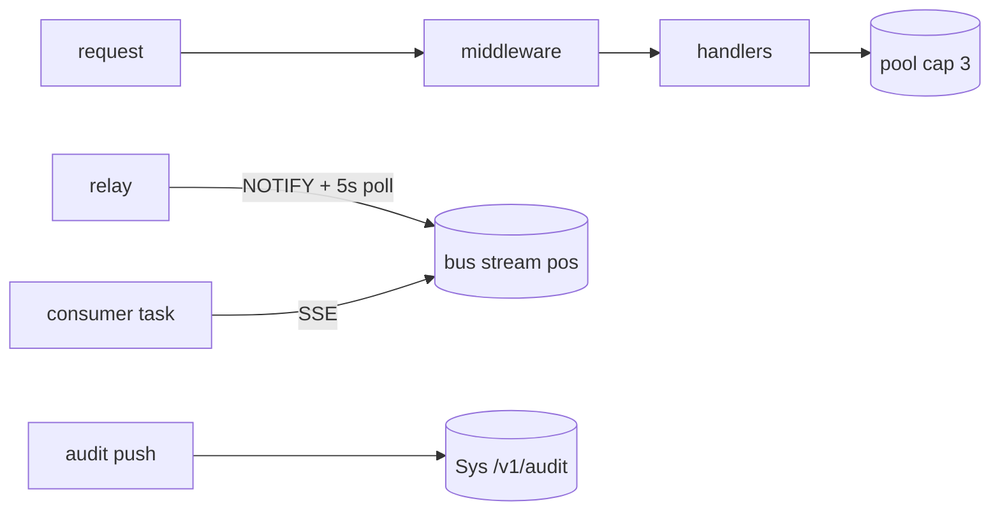

## 8. Invariants, Insecure-Defaults Rejected, Unsafe Rationale

- A check's payments total never exceeds its total without a refund flow.
- Room-charge settlement is idempotent per transaction id (minted deterministically).
- Void requires the check to be in a voidable state AND the manager-approval
  authority (ABAC attribute) where configured.
- No `unsafe`; no platform-schema access; no secrets stored.
- Insecure defaults rejected: no direct PMS tables access on room charge
  (only the documented API); no unsigned webhook-style money mutations.

## 9. Testing Strategy

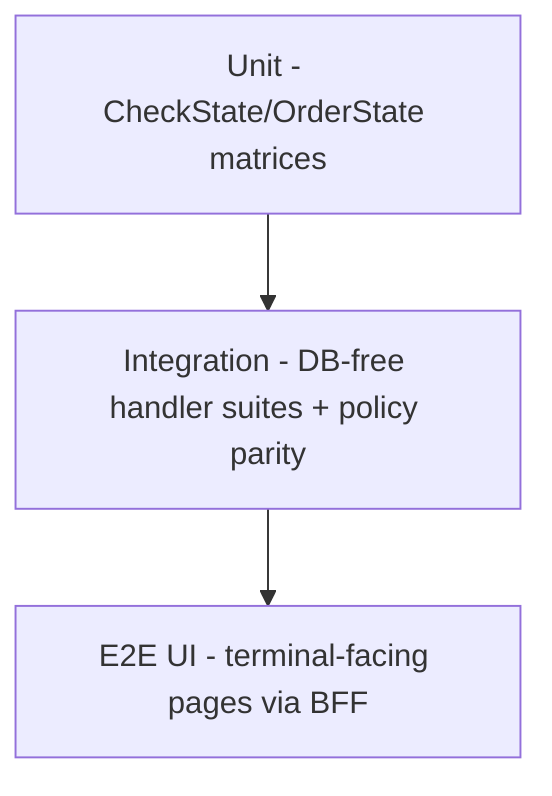

- Unit covers the full lifecycle matrices incl. held/void/refund gates.
- Integration asserts scope-mirror coverage and cross-service deny behavior.
- E2E covers table-side flows; payments instruction verification rides the
  platform's Payments tests.
- NOT tested here: Shield engine internals, TLS, Auth issuance.

## 10. Open Questions

- Pre-auth card handling at the table.
- KDS batching beyond per-order routing.
- Gratuity distribution rules.

---

**Design attribution:** hotel8:pos and its underlying concepts were designed by Hamid Jahanzad <Hamid@Jahanzad.com>.

